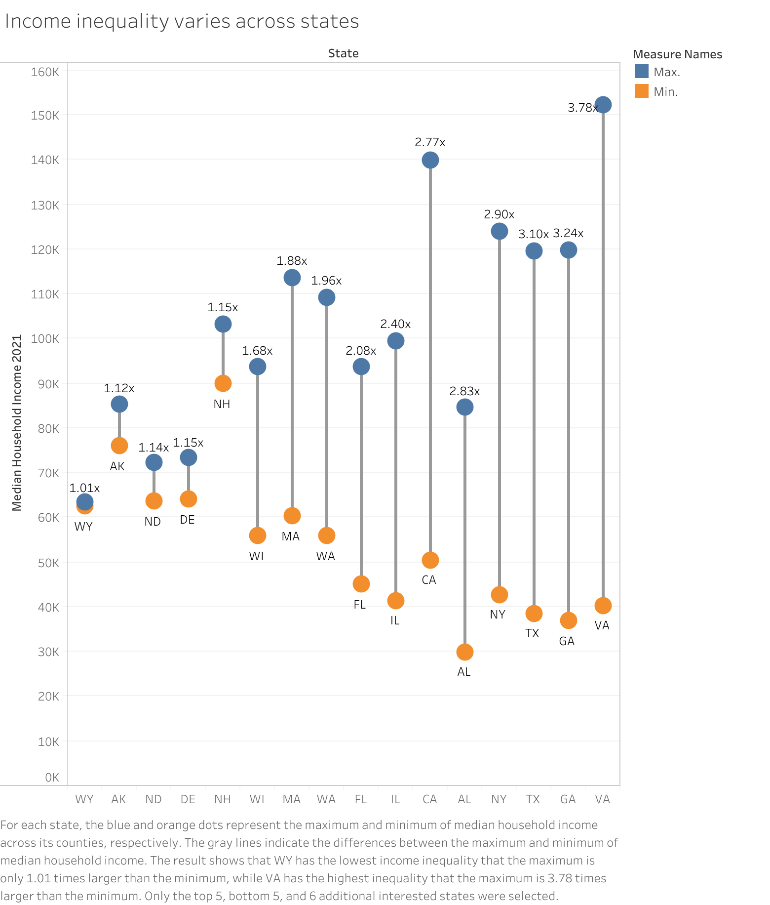

<!-- Source: https://pages.graphics.cs.wisc.edu/765-25/design-exercises/4-2/ -->

# Design Exercise 4-2: 2 Data Sets, 6 Visualizations in Design Exercises (List Page) September 9, 2025 (Last Modified: October 20, 2025)

In this Design Exercise, we are asking you to make **good** visualizations that tell interesting stories (answer questions) from the data sets we have been working with. You have 2 weeks to make 6 visualizations (subject to some requirements). You will also be asked to critique someone else’s visualization.

You will turn this assignment in on the Canvas Survey [Design Exercise 4-2: Visualizations from 2 data sets (due Fri, Oct 24)](https://canvas.wisc.edu/courses/476055/assignments/2758538).

## Introduction

For the past few weeks, we’ve been working with two data sets (see [A Tale of Two Data Sets](two-data-sets.md)). You’ve made exploratory visualizations, so you (hopefully) have some sense of what is in them. For this assignment, you need to make some “high quality” visualizations: ones that stand alone so that a viewer can get the story you are trying to tell.

You will need to pick 4 “stories to tell” (or, if you prefer “questions to answer”). The first story must be about the Life Expectancy data (either version). The second story must be about the Census data. Stories 3 and 4 are your choice.

For questions 1 and 2, you must provide two different visualizations that tell the same story. You can think of them as a primary and an alternate. You need to show two different designs. It’s OK if one is better than the other (although they both should be good). It’s a chance to show an alternate (but reasonable) encoding or design strategy. Or, if you prefer, target different audiences (make one for a newspaper audience, and another for a scientific journal). We will ask you to compare the two.

For all visualizations, your visualization must be a single-page static image. You can turn each in as an image file (PNG or JPEG or WEBP - please avoid Apple specific formats), an SVG file, or a PDF file. Each image is a separate file. Each visualization must have a title and appropriate labels and legends. Your visualization should probably have a caption (in the file). Your image file should stand alone (you cannot expect the viewer to see your rationale.)

You will be asked for the “question” or “story” and a “rationale” for the design. The rationale is an opportunity for you to explain the design choices that you made to tell the story well.

You will also be asked to provide a critique of someone else’s design. If you are part of the collaborative learning opportunity (CLO - [Design Exercise 4-1: OPT-IN exercise](de4-1.md)) you will have done this separately.

We will also ask you to explain how you made the visualization. List all tools that you used. If you use AI tools, please disclose them.

To help you understand how we assess assignments, we will have a class session where we review past student assignments (including examples from previous versions of this exercise) and give you an opportunity to evaluate visualizations yourself.

## Some ground rules…

In no particular order…

  - You need to create **static** visualizations: things that work in “print” (or just as an image file). If you create something interactive, we won’t see the interactivity.
  - Each visualization must be a single “picture” (one page, preferably PNG - if it’s a PDF it can only be 1 page). You can put multiple charts together into a single image, but remember - it must fit on a page/screen.
  - It is OK to use “approximately correct” years. (for example, to use 2003 urban codes to look at 2000 data)
  - You can use whatever tools you like. You will be asked what tools you used to complete the assignment. This includes things that fall under the [Course Policy on the use of Generative AI Tools](genai-policies.md)
  - We aren’t doing the actual social science here - these graphs are descriptive. We are showing (at most) correlation, not causality.
  - You can use the questions that you thought of from previous design exercises (but you should make better visualizations). We prefer that you do not use the questions that we (the course staff) have already posed in previous assignments. We will provide some ideas if you can’t think of anything.
  - You should not add data. You can use knowledge that you have (e.g., that there was a pandemic starting in 2019-2020, or a recession in 2007) but you shouldn’t try to augment the data by joining it with some outside source (like finding the GDP for each country).

## How will we grade this?

We will provide a more detailed rubric later. You can look at last year’s rubrics for concepts.

Your 6 visualizations will be graded on the 100 point, 90=A scale (like most things in class). The scoring considers the individual visualizations and the written parts (rationales). We will make an adjustment for “diversity” of stories and designs (e.g., if you turn in 6 bar charts, there might be a penalty - unless it is clear that bar charts truly are the best designs for each).

We will subtract penalties for not meeting expectations for other parts of the assignment. (-2 for nothing, 0 for “good enough”). These “other parts” include the required critique and the question about how you made the visualizations. In rare cases, we might give a bonus for something exceptional for one of these pieces.

[Evaluating Designs: Some thoughts on grading](evaluating-designs.md) provides terminology that we will use in evaluation. You will see the *Levels of Correctness* (Bad, Ugly, Good, Splendid) in this section. You will see *Types of Designs* and *Aspects of Responses* in our grading. The *Error Codes* are specific things we are looking for. These definitions not only help you understand what we’ve said, but they **give a strong hint for what we will be looking for in assignments.**

We will try to make the numbers work out so:

  - 91 or higher (high A, A+) - Many splendid aspects and no bad ones. Good outweighs ugly.
  - 90 (low A) - significantly more good than ugly, no bad, few (or no) splendid
  - 85-89 (AB) - some good elements (but balanced by ugly), few or no bad
  - 84 or lower - generally some bad elements, and a bad balance of ugly to good

Basically, we will look at your visualizations and assign codes (see the list below or on [Evaluating Designs: Some thoughts on grading](evaluating-designs.md)). We will consider the different aspects (also on that page). There is no simple numerical connection - there are too many different possible solutions (see types of designs on that page).

Here are some resources from last year:

  - [Feedback Codes](https://pages.graphics.cs.wisc.edu/765-24/posts/de5-codes/) - the kinds of comments we make on assignments. Should give you a sense of what we look for. We will have a new version of this for this year.
  - [Last Year’s Rubric](https://pages.graphics.cs.wisc.edu/765-24/posts/de-rubrics/) - Last year’s DE6 was similar to, but not the same as, this assignment. We will provide a more specific and quantitative version for this year.

## Some Hints

Here’s a great hint from a [2021 variant](https://pages.graphics.cs.wisc.edu/765-21/assigns/dc1/) of this assignment:

> … we are looking for explicit choices you made to emphasize your “story.” A “data dump” (just making a chart of some of the variables) is not likely to get you a good score. If you make explicit decisions - selecting subsets or data, highlighting particular points, arranging designs that emphasize certain aspects, etc. - this will be rewarded.

## Some notes on “A Good Question”

This is from the last version of the class:

For the purposes of this exercise, a “Good Question” has a non-standard (but still hand-wavy) definition: it will make for a good visualization.

I should also say that I am using the terms “Good Question” and “Stories in the Data” in a very similar way. The idea is to find something interesting in the data: you might phrase it as a question the data answers or a fact/pattern in the data (that would answer a question).

A good question/answer should be:

1.  Interesting (non obvious, ideally it is something that the course staff who has looked at this data hasn’t already seen; uniqueness is valued)
2.  Multi-variate (involve bringing together many variables)
3.  Taking advantage of visualization (Generally, this means the answer is complex. It could be a simple yes or no, but the visualization would have value to give context, or support the answer, or help address followup questions, …)
4.  Can actually be answered from the data (you could actually make a good visualization to answer the question)

While it is somewhat circular… a good question/story is one that leads to a good visualization to answer/tell it. Yes this is kind of weird: you can (should?) pick stories that let you show off your ability to tell stories with visualization.

Good questions (for this assignment) lead to solutions which do well with the following questions (the resulting visualizations):

  - Is the question/story interesting and clear?
  - Is it multi-variate?
  - Is the design effective? (is it well adapted to the story/task?)
  - Do the details represent good choices?
  - Is the design appropriate for the data?
  - Is the rationale properly stated (in the documentation)?
  - Is the design complete (it has enough of a caption that it stands alone)?

Of course, you should avoid “bad” practices (e.g., inappropriate encodings or aggregations).

## Some Example Questions/Stories

In the past, we’ve emphasized students coming up with their own questions/stories. New for this year: we are OK with you using our ideas. No promises that these are great or will lead to interesting stories/answers/visualizations. But you are welcome to try them. Or think of variants, or ways to enrich them, or …

  - We generally think of life expectancy as improving over time. There are exceptions (wars, famines). How common are these incidents? How quickly do the countries recover?
  - Generally, women have a longer life expectancy than men. Is this changing over time? Are these changes consistent across different places?
  - Is the population of the US getting more educated over time? Are the patterns of these changes different in different places? (regions, urban/rural, …)
  - How has the distribution of the population between urban and rural areas changed over time?
  - Is there a connection between education levels and unemployment? Does this change over time? Is it different in different types of places (urban vs. rural)?
  - Did the pandemic (2020) effect unemployment differently in rural and urban areas?
  - Do people migrate to places with higher (lower) incomes? Is this different for domestic/international migration?

## The Required Critique

If you participated in [Design Exercise 4-1: OPT-IN exercise](de4-1.md), you will have done (at least one) critique of a design for this assignment. You will also have received at least one critique - we ask you to tell us about it.

For everyone else… we will give you something to critique (from last year). You’ll do the same work. You just won’t be helping anyone else.

Here is one from last year (click on it to show it full size):

This is an actual example from last year’s assignment. You should not pick this design (or even the story it tells) as one of the things you turn in.

## The Canvas Survey Questions (in Canvas Order)

It’s slightly confusing because there are the 4 questions (that you make visualizations for) and then Canvas has its own numbering…

1.  If you **were not** part of the CLO… provide a critique as requested in the assignment.
    
    If you **were** part of the CLO… give the name of the person who you received a critique from (not the person whose work you critiqued) and give a one sentence statement about how good/helpful the critique was (it could be a good critique, but not helpful; or helpful but not good; but hopefully, it was both helpful and good).

2.  Give the “Story/Question 1” (the question about the Life Expectancy data set that you have created two visualization for). A single sentence (or two) should suffice.

3.  Upload your first visualization for Question/Story 1

4.  Provide the rationale for this visualization. What choices did you make so that it is effective at answering the question/telling the story?

5.  Upload your second Visualization for Question 1

6.  Provide your rationale for this visualization (Question 1 Alternate)

7.  Compare your two visualizations that answer Question 1. What are the pros/cons of each?

8.  Give the “Story/Question 2” (the question about the Census data set that you have created two visualization for). A single sentence (or two) should suffice.

9.  Upload your first visualization for Question 2

10. Provide your rationale for this visualization

11. Upload your second visualization for Question 2

12. Provide your rationale for this visualization

13. Compare the two visualizations you made for the second Question.

14. What is the question/story that Visualization 3 is supposed to answer (it can use either data set)

15. Upload your visualization for Question 3

16. Provide your Rationale for Visualization 3

17. What is the question/story that Visualization 4 is supposed to answer (it can use either data set)

18. Upload your visualization for Question 4

19. Provide your rationale for your Visualization for Question 4

20. Describe how you made these visualizations. Please list what tools you used and any data processing that you applied. If you used AI tools, please disclose them.
