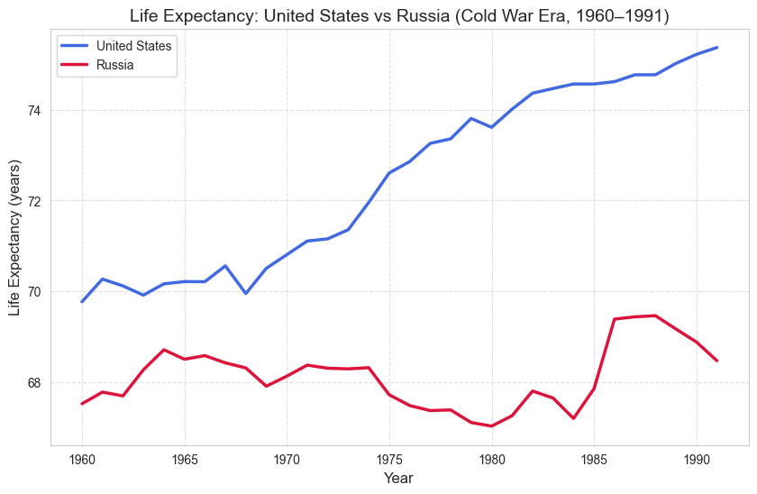
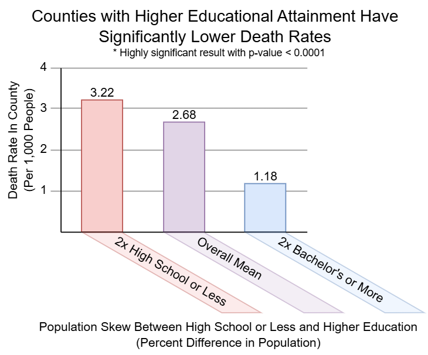
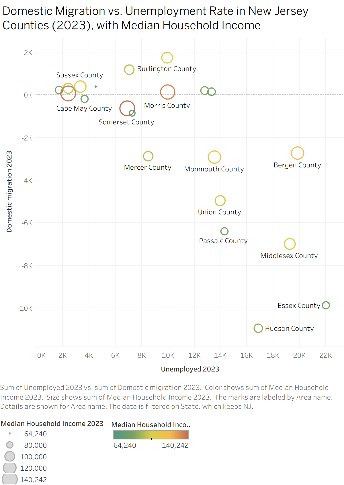
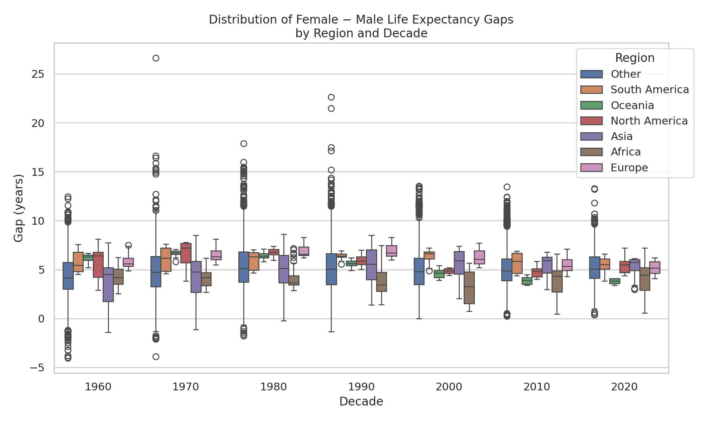
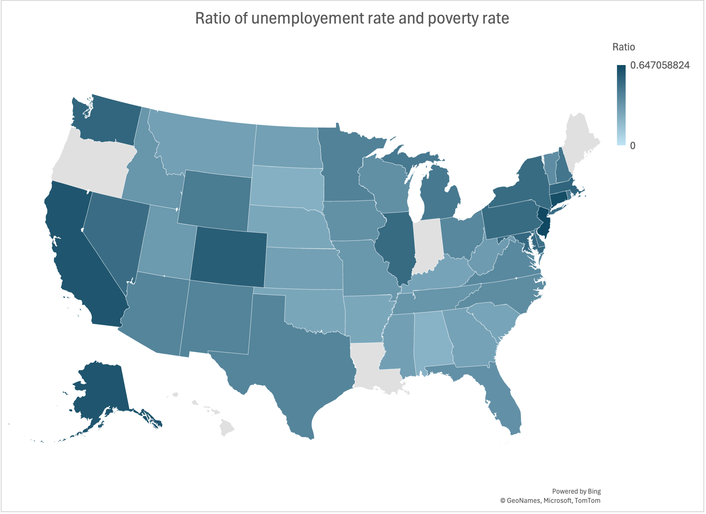
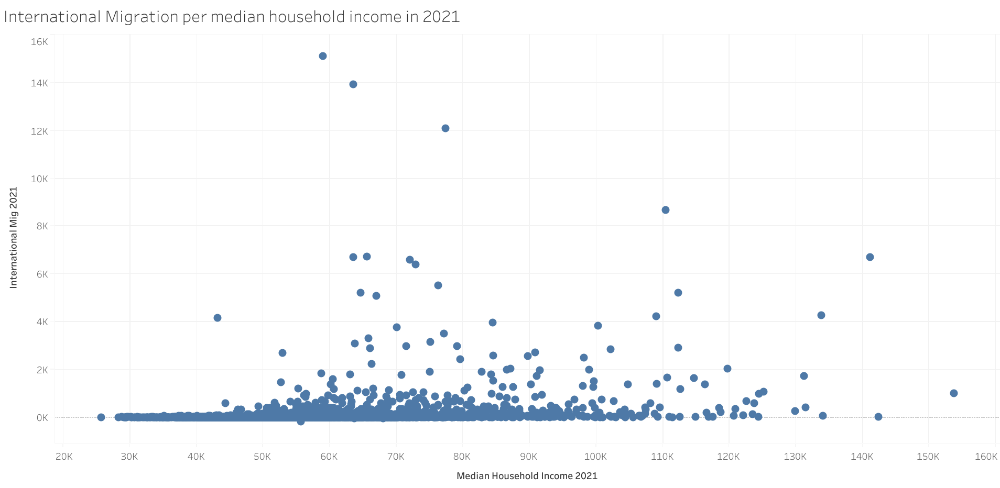
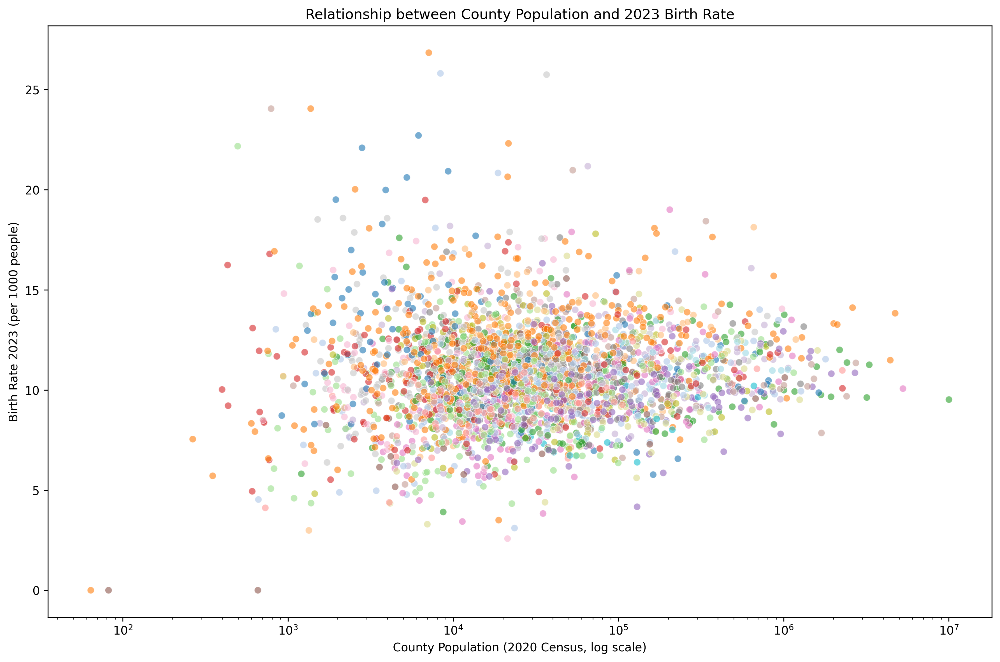
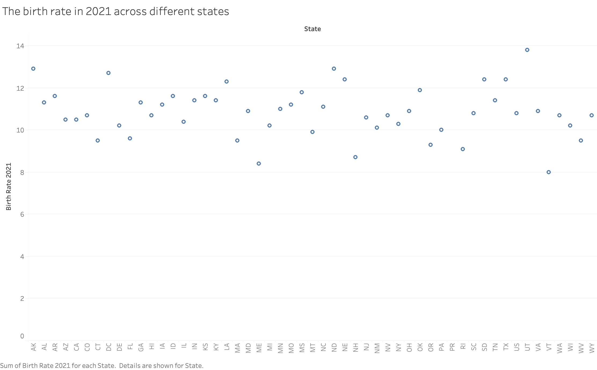

<!-- Source: https://pages.graphics.cs.wisc.edu/765-25/posts/module-3-rubric/ -->

# Module 3 Rubric in Posts October 23, 2025 (Last Modified: October 29, 2025)

As with Module 2, we’re providing a breakdown of our grading rubric for each assignment. This time, we also provide some examples for DE 3-2 - some from this assignment, some from previous years - along with the points they earn on the rubric. Ideally, this will clarify our intent with our grading scheme.

## Design Exercise 3-1

90: (at least) meets our expectations for A level work on this assignment (i.e., above average for a graduate student)

  - \+1-2: Bonus points for novel designs, attention to detail, “good” charts, and subjective impression

Each section was graded separately, with criteria determined by the requirements of that section.

Part A:

  - \-1 for each chart that is not the correct chart type
  - \-1 for each invalid chart
  - \-1 for each insufficient explanation

Parts B and C:

  - \-1: First chart is not reasonable
  - \-1: Second chart is not reasonable, or is the same chart type as the first
  - \-1: Not providing sufficient explanation

## Design Exercise 3-2

Due to the exploratory nature of these assignments, even your ‘refined’ vis from parts B and D are graded more leniently than work submitted as a “final” chart (as in 4-2). The charts that get extra points here meet our A-level expectation for a polished vis.

Even if you are satisfied with your grade, you will probably benefit from taking the time to look through these examples and evaluate them yourself.

90: (at least) meets our expectations for A level work on this assignment (i.e., above average for a graduate student)

  - \+1-4: Bonus points for novel designs, attention to detail, and subjective impression

Each section was graded separately, with criteria determined by the requirements of that section.

Parts A and C:

  - \-1: Not addressing the question asked
  - \-1: Not providing sufficient explanation

Parts B and D:

  - \-1: Question is not multivariate
  - \-1: No progression between vis
  - \-1: Second vis does not address the question
  - \-1-2: Not providing sufficient explanation

Part E:

  - \-1: Questions do not meet our expectation for graduate level work

Further points were deducted for each question where the expected question-rationale pair was not completed.

## Examples

The below are ‘graded’ as if they were a **second/final visualization** for parts B/D (which receive the strictest grading in Module 3). These charts were not necessarily created for that part of the assignment (or for this assignment at all\!), so this *does not necessarily indicate* the actual points assigned to the vis. (The TA collected these examples before looking at the full submissions with context.) If the goal is to make a rough draft or a sanity check, even “Bad” charts can be good for the task and can earn good scores.

Included are some examples without explanation - thinking about why *we* gave them this score, and about what score *you* might assign, is (we think) a good way to practice thoughtful critique.

\+1-2 points

Score: +2

Explanation:

  - \+1 vis clearly posits and answers question
  - \+1 deliberate and meaningful encoding choice (color)

Other examples with similar scores:

\+0 points

Score: +0

Explanation:

  - Solid use of encodings to show variables of interest - not a showstopping design, but great for exploration.

Another example with the same score:

\-1-2 points

Score: -2

Explanation:

  - \-1 for a poor choice of encoding (overcrowded, unlabeled scatterplot)
  - \-1 for not answering the question, as a direct consequence of the encoding choice

Other examples with similar scores:

## Seek and Find 3

90: (at least) meets our expectations for A level work on this assignment

\+1-2: Somewhat subjective bonus points

\-1-2: Meets our expectations; does not go further

## Content Survey 3

90: (at least) meets our expectations for A level work on this assignment

\-1-3: Lack of detail, or did not address the full question

\+1-2: Bonus points awarded for precision, detail, and/or subjective impression
