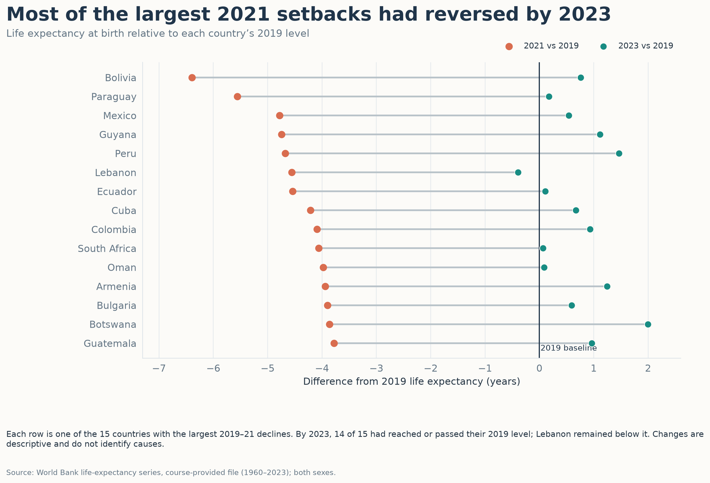
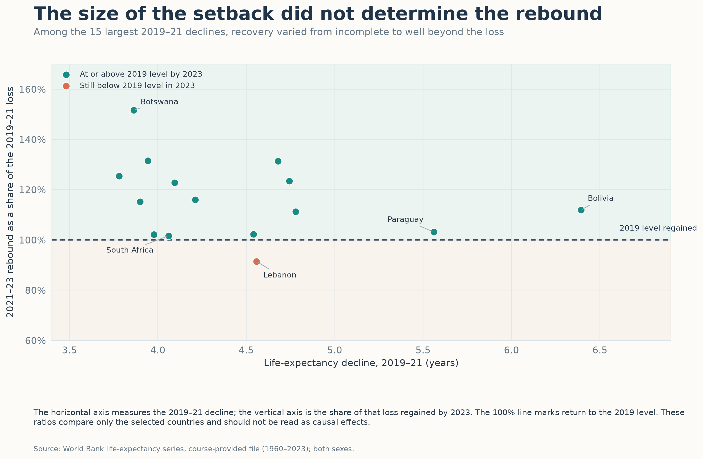
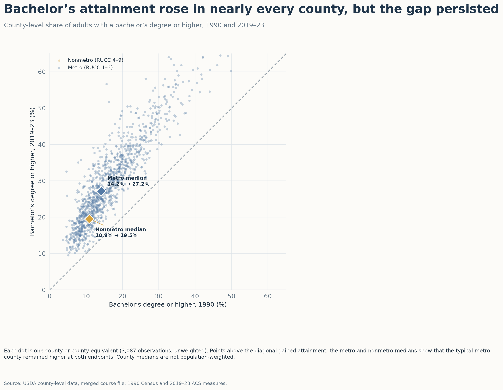
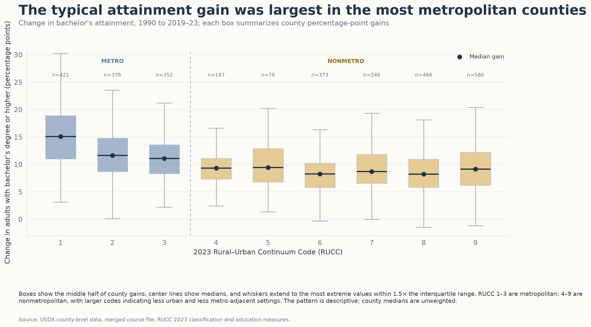
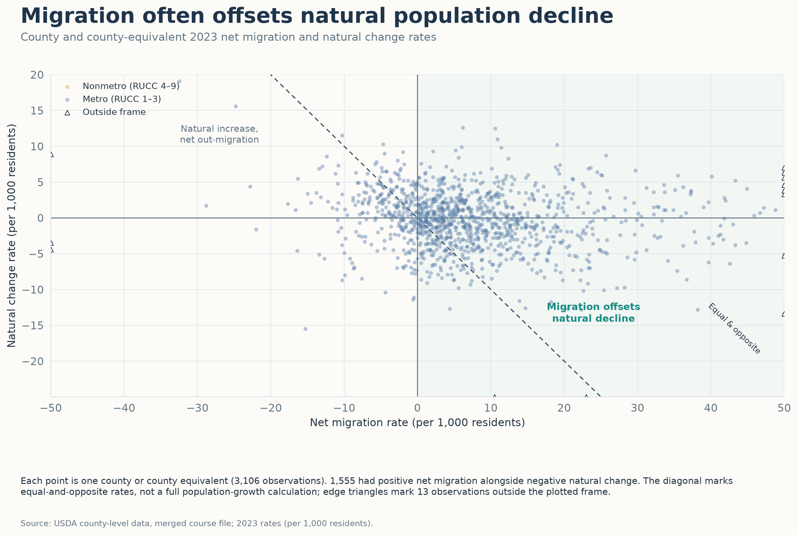
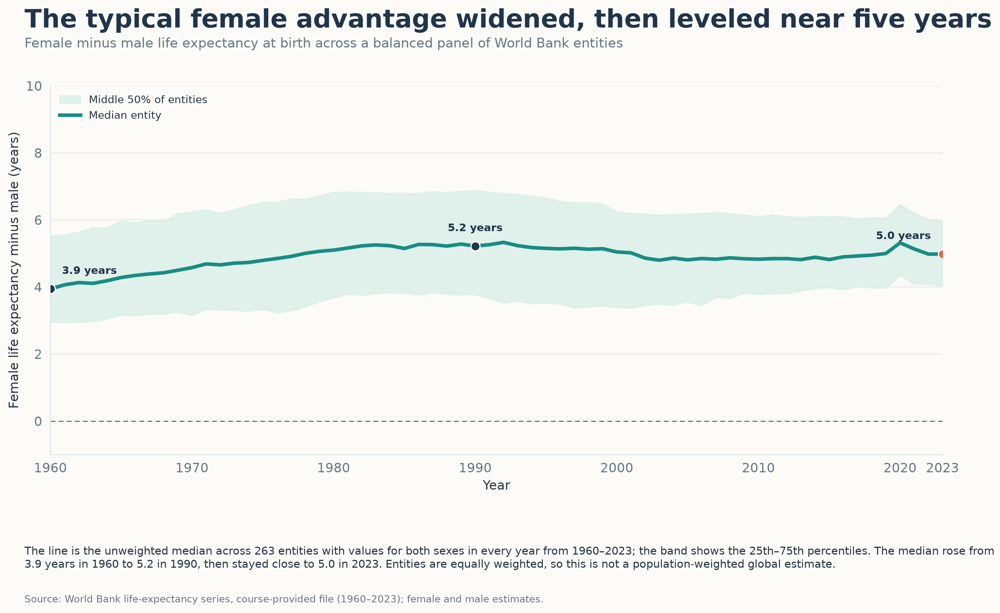

# Design Exercise 4-2 — Example Response

## 1. Critique of the provided income-inequality visualization

The connected endpoints make the within-state spread easy to compare, and the max/min ratio labels add a useful relative measure alongside the dollar values. The visual also uses a restrained palette and explains what the dots and lines mean.

The main limitation is the selection: only 16 states are shown, with six described as “interested states,” so the viewer cannot tell why those states were chosen or infer the full national range. The order of the states is also not explained, which makes it harder to scan the ratios. I would show all states sorted by the max/min ratio, or state a clear selection rule in the title and caption. A sorted ratio plot would make the inequality comparison immediate, while a companion range could retain the dollar context. The current figure is a good focused comparison, but its title and conclusion read more broadly than the selected sample supports.

## 2. Story/Question 1

Among countries with the largest life-expectancy declines from 2019 to 2021, which had returned to their 2019 level by 2023, and which had not?

## 3. First visualization for Question 1

File: `answers/figures/01_life_expectancy_recovery_deltas.png`

## 4. Rationale for the first visualization

I show each selected country’s 2021 and 2023 life expectancy as a difference from its own 2019 baseline. That puts the comparison on a common scale and makes return to baseline a clear zero line. The paired points show both the size of the initial decline and the amount recovered, while sorting rows by the 2021 decline makes the most severe drops easiest to find. Direct country labels and the color key let the figure stand alone. The caption limits the claim to the 15 countries with the largest declines in the supplied series; it does not attribute the changes to a particular cause.

## 5. Second visualization for Question 1

File: `answers/figures/02_life_expectancy_recovery_scatter.png`

## 6. Rationale for the second visualization

This alternate uses a scatterplot to compare two parts of the recovery: the horizontal position is the size of the 2019–21 decline, and the vertical position is the share of that loss regained by 2023. The 100% reference line gives a direct threshold for return to the 2019 level. The colors distinguish countries that were at or above baseline from those still below, and selected labels call attention to contrasting cases such as Bolivia and Lebanon. The view focuses on whether the size of the decline corresponds to the completeness of the rebound, while the first figure is better for reading every country’s year-to-year level relative to baseline.

## 7. Compare the two visualizations for Question 1

The first figure is the clearer overview: it names all 15 countries and shows their 2021 losses and 2023 positions relative to 2019 on one shared scale. Its main tradeoff is that it emphasizes absolute change, so differences in recovery relative to the size of the original loss are less obvious.

The scatterplot makes that proportional comparison explicit and brings out countries with similar decline sizes but different recovery shares. It is less useful for reading exact life-expectancy differences, and most countries are not labeled there. The recovery percentage is also specific to this selected set; the first figure provides the names and baseline-relative values needed to interpret it.

## 8. Story/Question 2

How did county-level bachelor’s attainment change from 1990 to 2019–23, and how did the change vary between metropolitan and nonmetropolitan counties?

## 9. First visualization for Question 2

File: `answers/figures/03_census_education_transition.png`

## 10. Rationale for the first visualization

Each point represents one county or county equivalent, with the earlier measure on the horizontal axis and the later measure on the vertical axis. The equality line makes increases immediately visible: points above it gained attainment. Color separates metro and nonmetro counties, and the larger diamonds mark each group’s median at both endpoints. This preserves the county-level spread while making the typical difference between the two groups easy to see. Counties are equally weighted, so the median describes a typical county rather than a typical resident.

## 11. Second visualization for Question 2

File: `answers/figures/04_census_education_rurality.png`

## 12. Rationale for the second visualization

This view focuses on the distribution of each county’s percentage-point gain rather than its two endpoint values. Boxplots compare the median and middle half of the gains across all nine 2023 Rural–Urban Continuum Codes. Group labels distinguish metropolitan codes 1–3 from nonmetropolitan codes 4–9, and the county counts show how much data contributes to each distribution. This reveals that the median gain is largest for the most metropolitan group and generally smaller for nonmetropolitan groups, while also showing substantial overlap. Hiding individual outliers keeps the distributions readable; the whisker definition is stated in the caption.

## 13. Compare the two visualizations for Question 2

The scatterplot is strongest for showing the before-and-after relationship and the variation among individual counties. It also makes the persistent metro/nonmetro difference at both endpoints clear. Its dense point cloud is harder to summarize across all nine rurality codes.

The boxplots summarize those code-level distributions and make the gain pattern easier to compare, but they hide individual counties and do not show the starting and ending attainment levels directly. Together, the views answer the same question at different levels: county trajectories first, then distributions of gains by rurality.

## 14. Story/Question 3

In 2023, where did positive net migration coincide with natural population decline, and was the migration rate greater or less than the natural-change rate?

## 15. Visualization for Question 3

File: `answers/figures/05_census_migration_balance.png`

## 16. Rationale for Visualization 3

The scatterplot places net migration rate against natural-change rate, so counties with positive migration and negative natural change fall in the lower-right quadrant. The zero lines divide the possible combinations, and the equal-and-opposite diagonal marks where the two rates balance each other. The metro/nonmetro colors add context without encoding another numeric measure. A symmetric frame keeps the rate comparisons legible; the caption identifies the edge triangles used for the few observations outside that frame. This compares two components of population change descriptively and does not claim that migration caused the natural-change pattern or that these two rates alone equal total population growth.

## 17. Story/Question 4

How did the female-minus-male life-expectancy gap change from 1960 to 2023 across places with a complete time series, and when did the typical gap change most?

## 18. Visualization for Question 4

File: `answers/figures/06_life_expectancy_gender_gap.png`

## 19. Rationale for Visualization 4

The line shows the median female-minus-male life-expectancy difference across a balanced panel of World Bank entities, and the shaded band shows the middle half of that distribution each year. This separates the typical trend from variation across entities. The labeled years make the main shape clear: the median rose from 3.9 years in 1960 to 5.2 years in 1990, then remained near five years through 2023. The zero reference line shows that the female estimate is higher when the gap is positive. Entities are equally weighted, including regional aggregates in the supplied file, so this is not a population-weighted global estimate.

## 20. How I made the visualizations

I used the course-provided World Bank life-expectancy and USDA county-level CSV files. I used Python 3.14 from the `p314` environment with pandas 3.0.6 for reshaping and calculations and Matplotlib 3.11.2 for the six static PNG figures. The reproducible script is `work/generate_figures.py`; the instructions are in `work/README.md`. No packages were installed and no manual editing was needed.

For Question 1, I calculated the 2019–21 decline, the 2021–23 rebound, the 2023 difference from the 2019 baseline, and the fraction of the decline regained for the 15 countries with the largest declines. For Question 2, I compared the 1990 and 2019–23 bachelor’s-attainment percentages, calculated county percentage-point gains, and grouped counties by 2023 Rural–Urban Continuum Code. For Question 3, I plotted the supplied 2023 net-migration and natural-change rates for counties with both values. For Question 4, I subtracted the male estimate from the female estimate and retained the 263 entities with both-sex series in every year from 1960 to 2023.

OpenAI ChatGPT/Codex contributed the story selection, data-analysis and plotting code, figure design, critique, and written responses. The instructor requested this complete example for private instructional review; it is not a student’s independent work. I used only the files saved with the assignment and did not open external pages.
