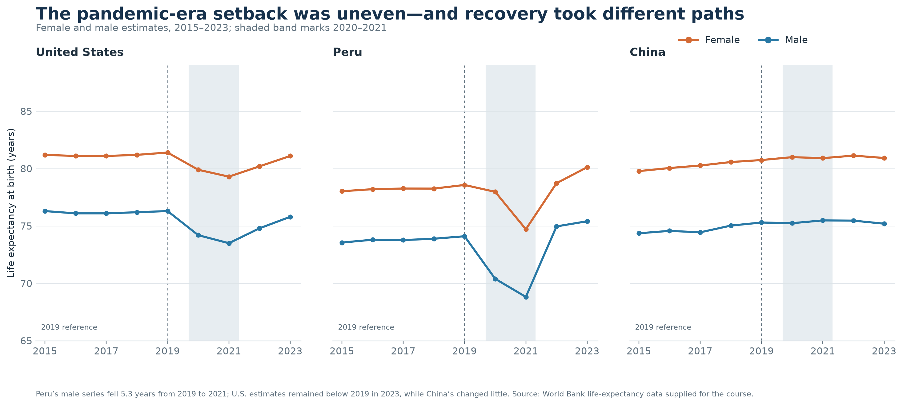
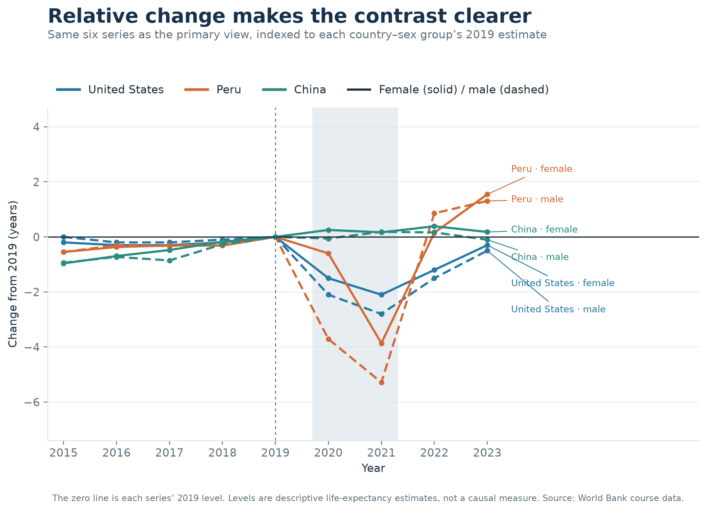
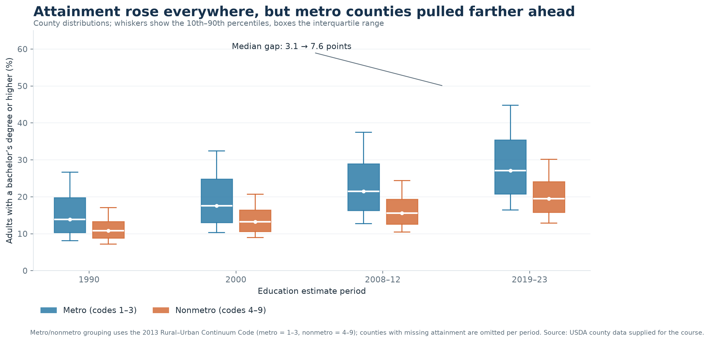
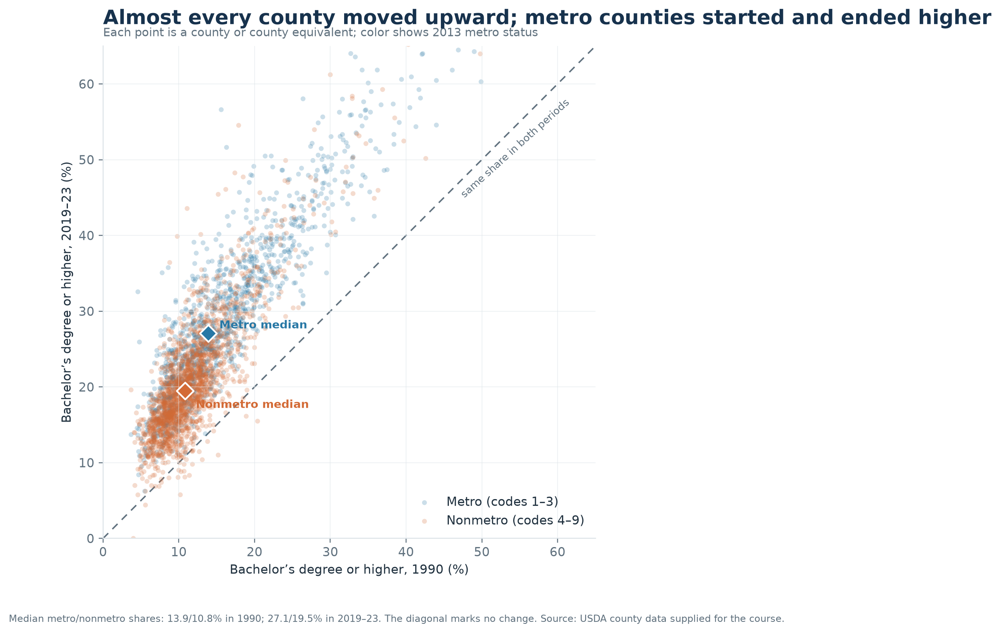
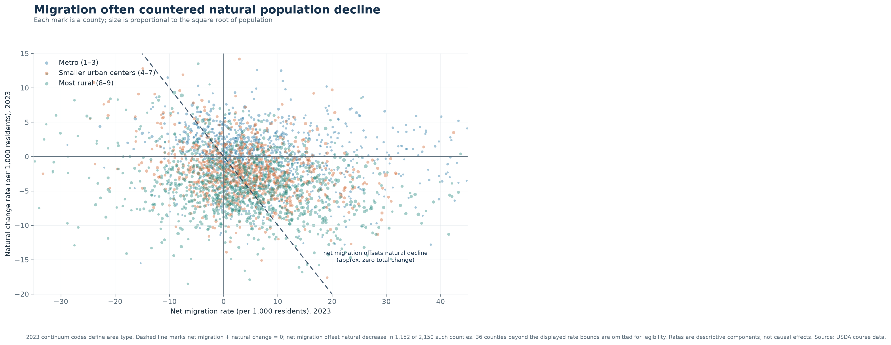
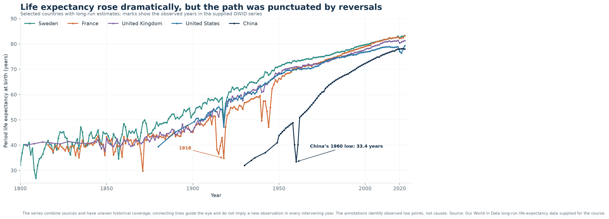

# Design Exercise 4-2 — Example response

*Prepared with AI for the instructor’s private review.*

### 1. Critique

The range marks make county income variation within each selected state easy to compare, and the ratio labels add a useful summary. The main issue is that the title sounds like a claim about all states, while the chart shows only 16 selected states; the six “additional interested states” have no stated selection rule. I would either show all states ordered by max-to-min spread or make the title explicit that these are selected examples. I’d also replace the generic “Measure Names” legend with “Maximum” and “Minimum,” and sort the states by the comparison being emphasized.

### 2. Story/Question 1

From 2015 to 2023, how did the pandemic-era life-expectancy setback differ by sex in the U.S., Peru, and China, and which estimates had returned to their 2019 levels by 2023?

### 3. Visualization 1

### 4. Rationale for Visualization 1

The three small multiples keep each country readable while using the same y scale, so the size of the changes remains comparable. Sex is encoded consistently by color, and the 2019 reference line and 2020–21 shading orient the viewer without implying that every country had the same timing. I chose these three countries because their series show contrasting patterns: a deep trough in Peru, a substantial drop in the U.S., and little change in China.

### 5. Visualization 1 Alternate

### 6. Rationale for Visualization 1 Alternate

This version indexes each country–sex series to its own 2019 estimate and puts all six on one zero-centered scale. That makes the size and timing of declines and rebounds easier to compare, while color and line style distinguish country and sex. Direct labels identify each series at the end. The 2019 baseline makes relative change clear but removes the absolute life-expectancy levels.

### 7. Compare the two visualizations for Question 1

The first chart is easier to read as a set of country-specific histories and preserves the actual life-expectancy levels. The second makes the different paths since 2019 much easier to compare, especially Peru’s sharp trough and rebound, but takes more decoding and hides the large level differences between countries. I’d use the first for a general audience and the second when the main task is comparing the pandemic-era changes.

### 8. Story/Question 2

How did county-level bachelor’s-degree attainment change from 1990 to 2019–23, and did the gap between metro and nonmetro counties narrow or widen?

### 9. Visualization 2

### 10. Rationale for Visualization 2

The paired boxplots show both the rise in attainment and the spread across counties in each period. Using the same two colors throughout makes the metro/nonmetro comparison quick to follow. I grouped counties using the 2013 Rural–Urban Continuum Code so the same classification can be used across all four education periods. The median gap grows from 3.1 percentage points in 1990 to 7.6 points in 2019–23, even as both distributions move upward.

### 11. Visualization 2 Alternate

### 12. Rationale for Visualization 2 Alternate

Each point compares one county’s 1990 and 2019–23 attainment, so the diagonal marks no change and the distance above it shows the size of the increase. The median diamonds keep the metro/nonmetro contrast visible without hiding the county-level variation. This view makes it clear that most counties moved upward and that metro counties had higher median attainment at both endpoints.

### 13. Compare the two visualizations for Question 2

The boxplots are better for comparing distributions over all four periods; they show the changing spread and make the widening median gap explicit. The scatterplot keeps the before-and-after pairing for individual counties and makes the overall upward movement intuitive, but the dense point cloud is harder to read and it omits the two intermediate periods. Together, the first is the clearer summary and the second shows how much counties differ from one another.

### 14. Story/Question 3

In 2023, how did net migration and natural population change combine across counties with different levels of rurality, and how often did migration offset natural decline?

### 15. Visualization 3

### 16. Rationale for Visualization 3

The scatterplot treats net migration and natural change as separate components, with the dashed diagonal marking where their sum is zero. Points above that line have enough net migration to offset natural decline; points below it do not. Color groups counties by 2023 continuum code, while point size gives a sense of population. Among counties with negative natural change, net migration fully offset it in 1,152 of 2,150 cases. The chart describes a relationship, not a causal effect, and 36 counties outside the displayed rate bounds are omitted for readability.

### 17. Story/Question 4

How did life expectancy rise across countries with long-run estimates, and where do the historical series show sharp reversals along the way?

### 18. Visualization 4

### 19. Rationale for Visualization 4

The shared time axis makes the long rise visible across countries, while the annotations draw attention to two unusually low observations: France in 1918 and China in 1960. I show the years present in the supplied data and note that coverage is uneven; the connecting lines guide the eye rather than suggesting that each historical year was observed. The annotations identify the lows without assigning a cause.

### 20. How I made the visualizations

I used Python 3.14 with pandas and Matplotlib, along with the course-provided CSV files. For the World Bank series, I selected the U.S., Peru, and China, male and female estimates, and years 2015–23; the alternate subtracts each series’ 2019 value. For the Census charts, I used the full county file, retained counties with valid continuum codes, and grouped 2013 codes 1–3 as metro and 4–9 as nonmetro. The second Census story uses 2023 net-migration and natural-change rates and the 2023 continuum codes; I omitted 36 counties outside the displayed rate bounds. For the long-run chart, I selected five countries from the supplied Our World in Data series and plotted the observed years from 1800 onward.

OpenAI Codex proposed the stories and designs, analyzed the supplied data, wrote the plotting script, generated the figures, and drafted the critique and written responses. No external webpages were opened.
