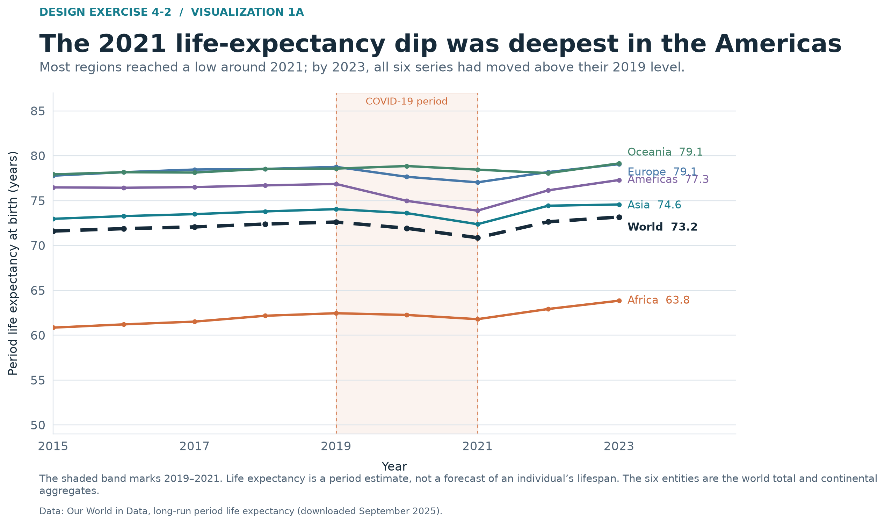
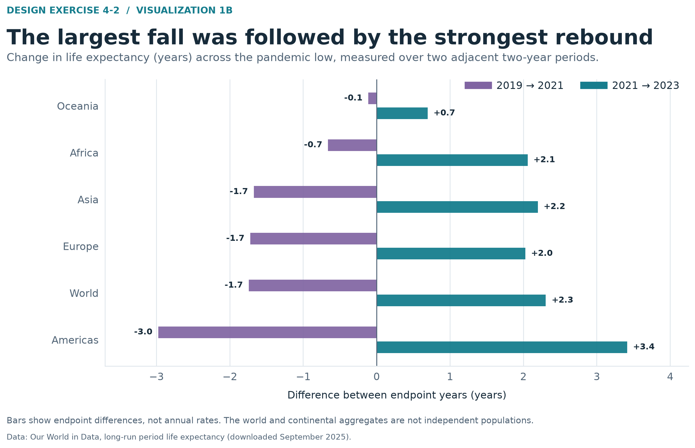
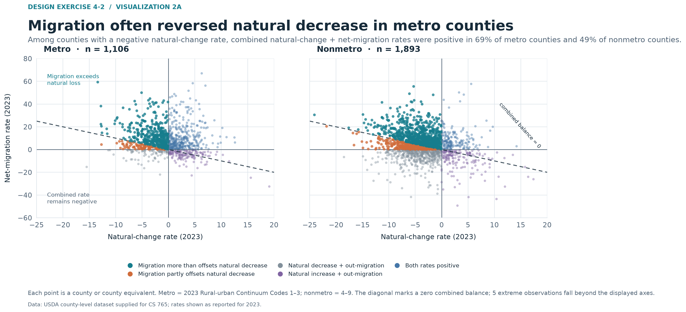
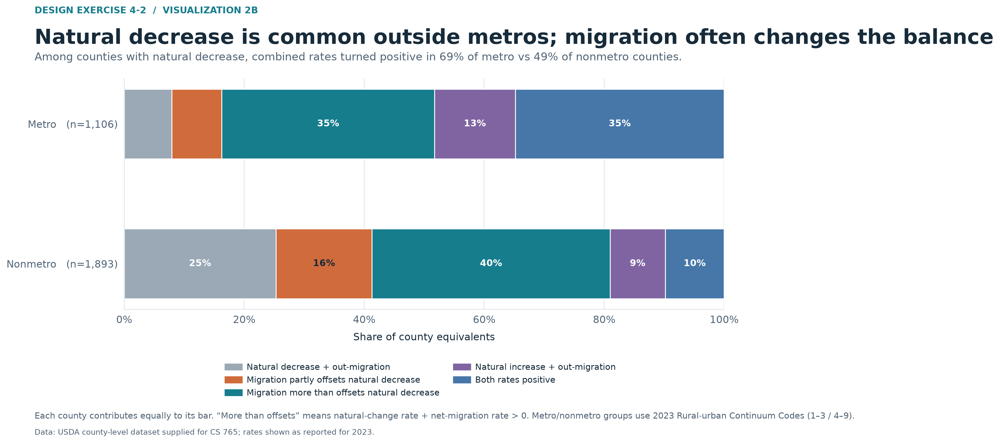
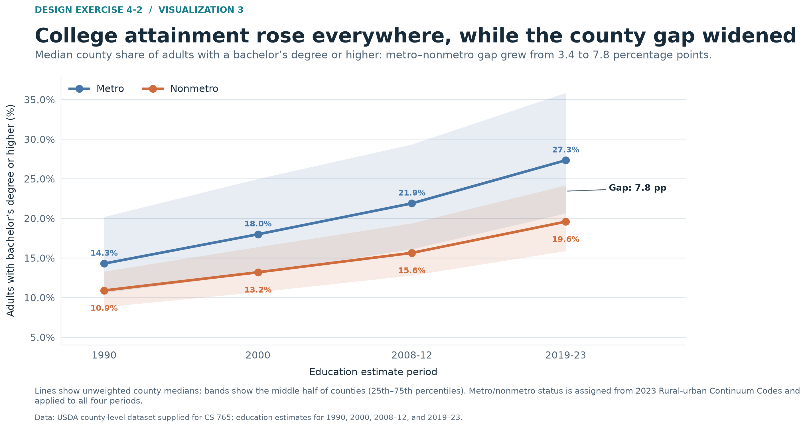
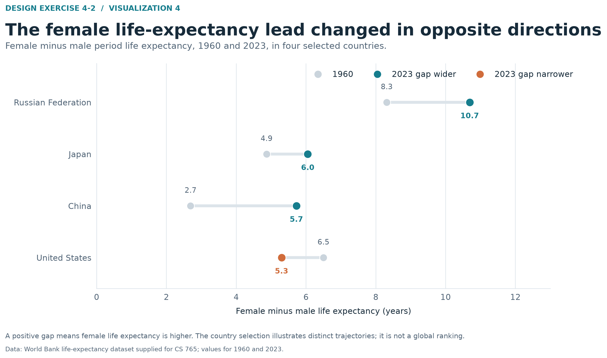

# Design Exercise 4-2 — Example Responses

## 1. Critique

For the non-CLO version of this question: the range marks and direct ratio labels make differences in county household-income ranges easy to scan, and the caption explains what the endpoints represent. The chart would be clearer if it stated why these 16 states were selected and ordered them by a meaningful measure such as the max-to-min ratio; the current state order makes comparisons harder, while several minimum values sit close together near the bottom of the chart. I would also make the legend more explicit by naming these as the highest and lowest county median household incomes within each selected state.

## 2. Story/Question 1

How did period life expectancy in the world and continental aggregates change during the COVID-19 period, how large was the 2019–2021 decline in each, and had each series returned to its 2019 level by 2023?

## 3. Visualization 1A

## 4. Rationale for Visualization 1A

The line chart preserves the annual sequence from 2015 through 2023, so viewers can see the pre-pandemic direction, the dip, and the recovery in context. I shaded 2019–2021 and used direct labels at the 2023 endpoints to focus attention on the interruption and the status by the end of the series. The world aggregate is dashed and slightly heavier so it remains distinct from the continental lines. The vertical axis stays in years because the question concerns actual life expectancy levels as well as changes. The note clarifies that these are period estimates and that the world and continental series are aggregates.

## 5. Visualization 1B

## 6. Rationale for Visualization 1B

This alternate reduces each series to two endpoint differences: 2019–2021 and 2021–2023. Bars extend from a shared zero line, making it easy to compare the size of the decline and the subsequent rebound across regions. The Americas stand out in both intervals, with the largest fall and largest rebound. This design deliberately gives up the year-by-year path to foreground the interval comparison.

## 7. Compare the two visualizations for Question 1

Visualization 1A gives more context: it shows when each series changed direction and how closely the higher-life-expectancy regions track one another. Its multiple lines make small differences among those regions harder to compare. Visualization 1B makes the decline and rebound magnitudes easier to rank, but it hides what happened in 2020 and 2022 and does not show the full time path. The two designs therefore emphasize trajectory and magnitude, respectively.

## 8. Story/Question 2

Among counties with a negative natural-change rate in 2023, how often was net migration large enough to make the combined natural-change and net-migration rate positive, and did that differ between metro and nonmetro counties?

## 9. Visualization 2A

## 10. Rationale for Visualization 2A

The scatterplot places natural-change rate and net-migration rate on perpendicular axes, with separate panels for metro and nonmetro counties. The dashed diagonal marks where the two rates sum to zero. Color distinguishes counties where migration more than offsets natural decrease, migration partly offsets it, and the other sign combinations. This makes both the individual county patterns and the metro/nonmetro difference visible: among counties with negative natural change, the combined rate is positive for 69% of metro counties and 49% of nonmetro counties. I clipped five extreme observations beyond the displayed axes so the main cloud remains legible, and noted that choice in the figure.

## 11. Visualization 2B

## 12. Rationale for Visualization 2B

The 100% stacked bars summarize the same county patterns as shares of each place-type group. The color for counties where migration more than offsets natural decrease is prominent, while the other segments show how common partial offsets, continued decline, and positive natural change are. This makes the group comparison quick to read. Each county contributes equally, so the chart describes counties rather than the share of the US population living in each pattern.

## 13. Compare the two visualizations for Question 2

Visualization 2A retains the rate magnitudes and makes the zero-balance threshold explicit, so it shows how far individual counties fall from that boundary. Its many points make the overall distribution denser. Visualization 2B removes those magnitudes and locations, but the proportions are easier to compare at a glance. It is a clearer summary of how common each pattern is, while the scatterplot gives more detail about the rates behind those shares.

## 14. Story/Question 3

Did the median county share of adults with a bachelor’s degree or higher rise from 1990 to 2019–23, and did the difference between metro and nonmetro counties widen?

## 15. Visualization 3

## 16. Rationale for Visualization 3

The two lines make change across four education-estimate periods easy to follow, while the shaded bands show the middle half of counties in each group. I use the median county rather than a population-weighted average so a few very populous counties do not dominate the comparison. The endpoint labels and gap annotation emphasize that both medians increased while the metro–nonmetro gap widened from 3.4 to 7.8 percentage points. Metro status is based on 2023 continuum codes and applied to all periods, as stated in the figure note.

## 17. Story/Question 4

Between 1960 and 2023, how did the female-minus-male life-expectancy gap change in China, Japan, Russia, and the United States, and did it move in the same direction in all four?

## 18. Visualization 4

## 19. Rationale for Visualization 4

The dumbbell chart directly compares the gap at the two endpoints for each country. A shared horizontal scale makes the size of the gaps comparable, and the connecting line shows whether each gap widened or narrowed. Teal marks a wider 2023 gap and orange a narrower one. The selected countries show different trajectories: the gap narrowed in the United States and widened in China, Japan, and Russia. The note makes clear that these four countries illustrate contrasting examples rather than a global ranking.

## 20. How I made the visualizations

OpenAI Codex generated this instructional example at the instructor’s request. It helped choose the stories, analyzed the supplied datasets, wrote the Python data-processing and plotting code, generated all six figures, and drafted these responses. This is substantial AI assistance, not just proofreading. The instructor should review the example before using it for teaching.

I used Python from the `p314` environment with pandas for data filtering, grouping, and summaries, and Matplotlib for the static PNG figures. I did not install packages or use online sources.

For Question 1, I used the supplied Our World in Data life-expectancy file, selected the world and five continental aggregates, and filtered to 2015–2023 for the annual line chart. For the alternate, I calculated differences between 2019 and 2021 and between 2021 and 2023.

For Question 2, I read the supplied county-level Census file, kept county and county-equivalent rows with valid 2023 rural–urban continuum codes and rates, and grouped codes 1–3 as metro and 4–9 as nonmetro. I compared natural-change and net-migration rates, then calculated their sum to distinguish a partial offset from a positive combined balance. The alternate aggregates each county into one of five rate-pattern categories and displays each category as a share of its metro or nonmetro group.

For Visualization 3, I calculated the median and 25th and 75th percentiles of the county bachelor’s-degree-or-higher percentage for 1990, 2000, 2008–12, and 2019–23, grouped by the same 2023 metro/nonmetro classification. For Visualization 4, I reshaped the supplied World Bank life-expectancy data by sex, calculated female minus male life expectancy, and compared 1960 with 2023 for four selected countries.
