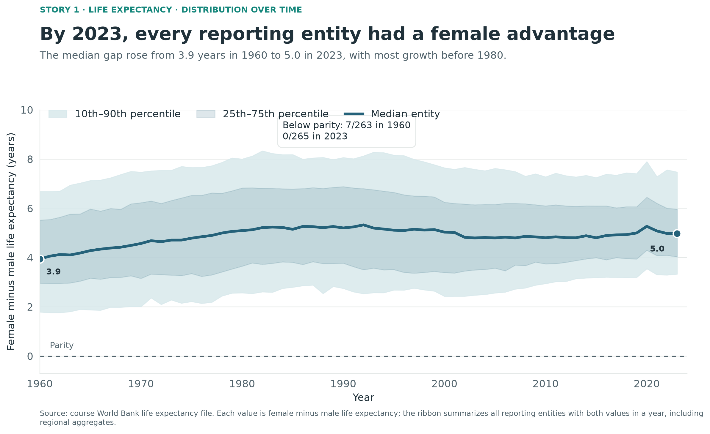
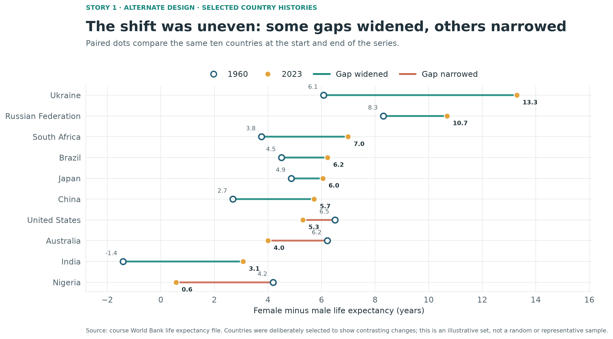
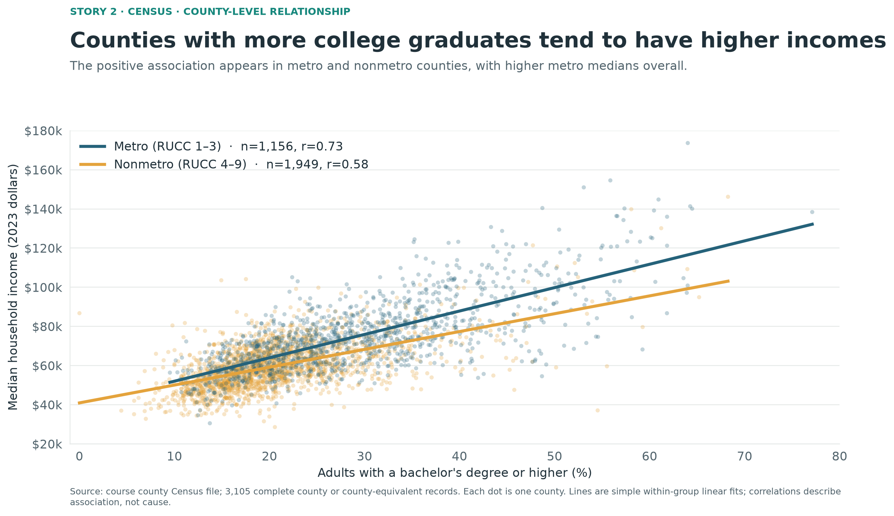
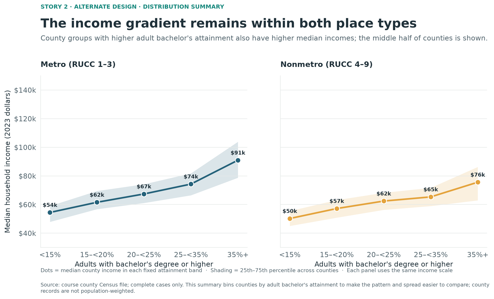
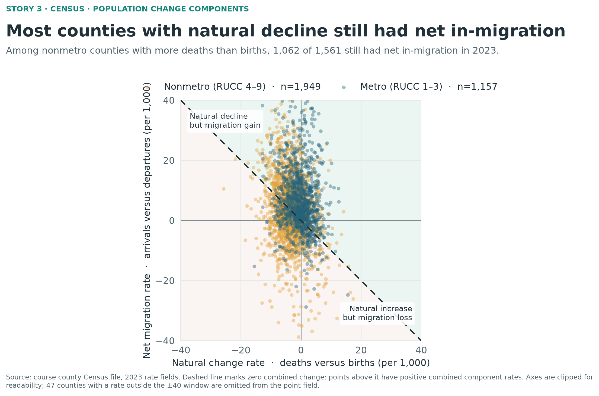
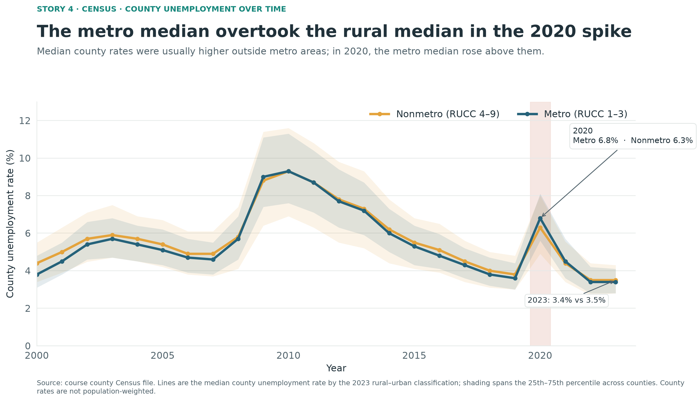

# Design Exercise 4-2 — Instructor example response

### 1. Critique

**Illustrative non-CLO critique.** The paired maximum/minimum dots and connecting ranges make within-state extremes easy to compare, and the ratio labels communicate the intended spread without requiring mental arithmetic. The title and caption also state the main takeaway directly.

The design uses only two counties per state, so one unusually high or low county can determine the whole state’s “inequality” score; viewers cannot see the rest of each county distribution. The six additional states are not explained, and the zero-based income axis leaves considerable empty space that makes the differences harder to compare. I would show the county distributions for a clearly defined set of states—such as sorted box plots or county dots with a median and middle-50% interval—and explain any state selection. That would retain the comparison while showing whether the extremes are typical.

### 2. Story/Question 1

How has the difference between female and male life expectancy changed since 1960, and how much does that change vary across the reporting entities in the World Bank file?

### 3. First visualization for Question 1

### 4. Rationale for Visualization 1

I calculate the gap as female life expectancy minus male life expectancy, so zero has a clear meaning: parity. The median line answers what happened to a typical reporting entity, while the 25th–75th and 10th–90th percentile bands show how much the pattern varies. The direct labels compare the median at the beginning and end; the parity callout makes the change in direction easy to notice. I retained regional aggregates from the file and call them “reporting entities” so the chart does not imply that every row represents a country.

### 5. Second visualization for Question 1

### 6. Rationale for Visualization 1 Alternate

This connected-dot design compares the same selected countries at two endpoints. The direction and length of each connector show whether the female advantage grew or narrowed, while the country labels make contrasting histories concrete. The colors redundantly identify widening and narrowing, and direct values preserve the scale. The set is deliberately illustrative rather than representative; the figure caption says so.

### 7. Compare the two visualizations for Question 1

The distribution chart gives the broadest view: it shows the overall shift and the spread year by year, but it hides which places drive the variation. The country comparison makes specific reversals and large changes easy to identify, but it omits the intervening years and most reporting entities. The first is better for a general trend; the second is better for discussing examples.

### 8. Story/Question 2

Across counties, do places with a larger share of adults holding a bachelor’s degree also have higher median household income, and does that relationship differ between metro and nonmetro counties?

### 9. First visualization for Question 2

### 10. Rationale for Visualization 2

Each dot is a county, with education and income on position so their association can be seen directly. Color separates 2023 RUCC codes 1–3 (metro) from codes 4–9 (nonmetro); separate fitted lines and correlations help compare the relationship within each group. The figure reports the complete-case counts and describes the correlations as associations, not causes. This view retains individual county variation, though overlapping dots make the densest part of the distribution harder to read.

### 11. Second visualization for Question 2

### 12. Rationale for Visualization 2 Alternate

This design summarizes counties in five fixed bachelor’s-attainment bands and facets the summaries by metro status. A dot shows median county income and the shaded band shows the middle half of counties in that attainment band. The shared income scale supports direct metro/nonmetro comparisons, while binning reduces overplotting and foregrounds the income gradient. The tradeoff is that individual counties and variation inside each band are less visible.

### 13. Compare the two visualizations for Question 2

The scatter plot is more useful for seeing outliers, overlap, and the range of county-level observations. The binned view is easier to read as a comparison of broad patterns and income distributions, especially between metro and nonmetro areas. Binning makes the gradient clearer but conceals detail and depends on the chosen attainment bands.

### 14. Story/Question 3

When counties had more deaths than births in 2023, how often did net migration move in the opposite direction, and was it enough to produce positive combined population change?

### 15. Visualization for Question 3

### 16. Rationale for Visualization 3

The scatter plot places the two components of population change on separate axes, with zero lines distinguishing increase from loss. Color compares metro and nonmetro counties. The dashed diagonal marks where the two rates sum to zero: points above it have positive combined component rates, while points below it have negative combined rates. The highlighted count shows that net migration was positive in 1,062 of 1,561 nonmetro counties with natural decrease, without implying that migration fully compensated for the loss in every one. The axes are clipped at ±40 per 1,000 to keep the main cluster legible; the caption reports how many records fall outside that window.

### 17. Story/Question 4

How did the usual difference between metro and nonmetro county unemployment rates change from 2000 to 2023, particularly during the sharp 2020 increase?

### 18. Visualization for Question 4

### 19. Rationale for Visualization 4

The two time series show median county unemployment rates for metro and nonmetro counties, classified using the 2023 RUCC codes. The percentile bands show how county rates are distributed within each group, and the 2020 highlight directs attention to the sharp reversal: the metro median was 6.8%, compared with 6.3% for nonmetro counties. A smaller crossover also appears in 2009. By 2023 the medians were close again, at 3.4% and 3.5%. These are descriptive comparisons of county rates; counties are not weighted by population.

### 20. How I made the visualizations

OpenAI Codex (GPT-6) generated the story choices, chart designs, analysis code, figures, critique, and written responses in this instructor-requested example. I used Python 3.14 from the `p314` environment with pandas to read and summarize the provided files, NumPy for calculations and trend lines, and Matplotlib to make the six static PNG figures. I did not install packages or consult external webpages; I used only the local `reference/` and `data/` materials.

For life expectancy, I matched male and female observations by reporting entity and year, calculated female minus male life expectancy, then computed yearly medians and percentile bands. Regional aggregate rows were retained in the distribution figure; the alternate figure uses ten named countries selected to show contrasting changes.

For Census figures, I used complete cases for the variables shown, grouped counties by 2023 RUCC code (1–3 metro; 4–9 nonmetro), and summarized county-level rates, income, and education as described in the figure captions. The education-income scatter uses simple within-group linear fits and Pearson correlations; its alternate bins counties by education and summarizes median income and its interquartile range. I used the dataset’s 2023 natural-change and net-migration rates directly, and summarized each year’s unemployment rates by median and interquartile range. All figures are generated by `work/generate_figures.py`; no manual image editing was needed.
