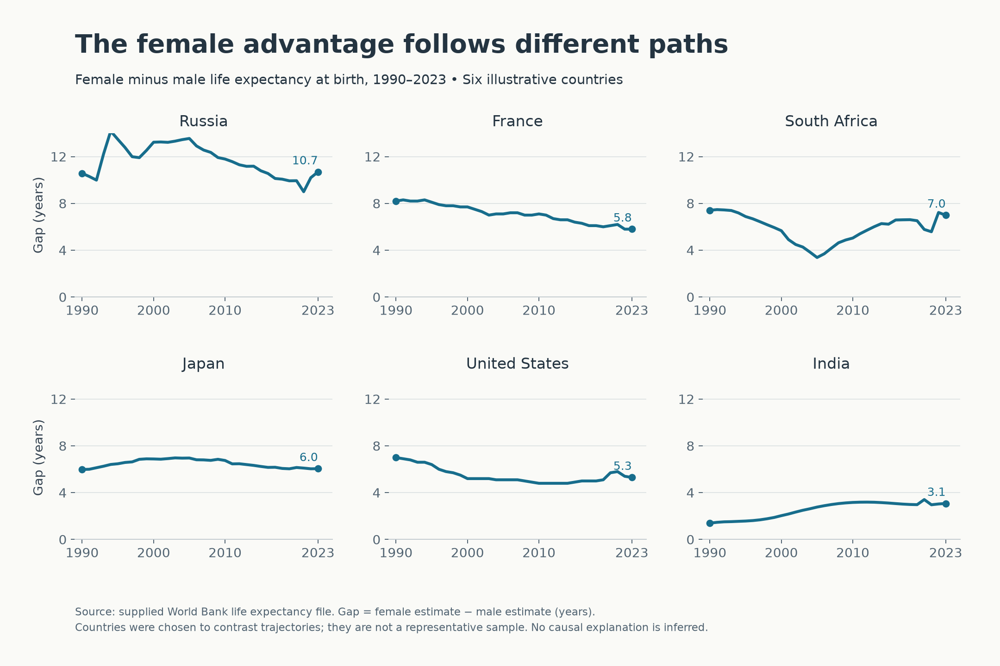
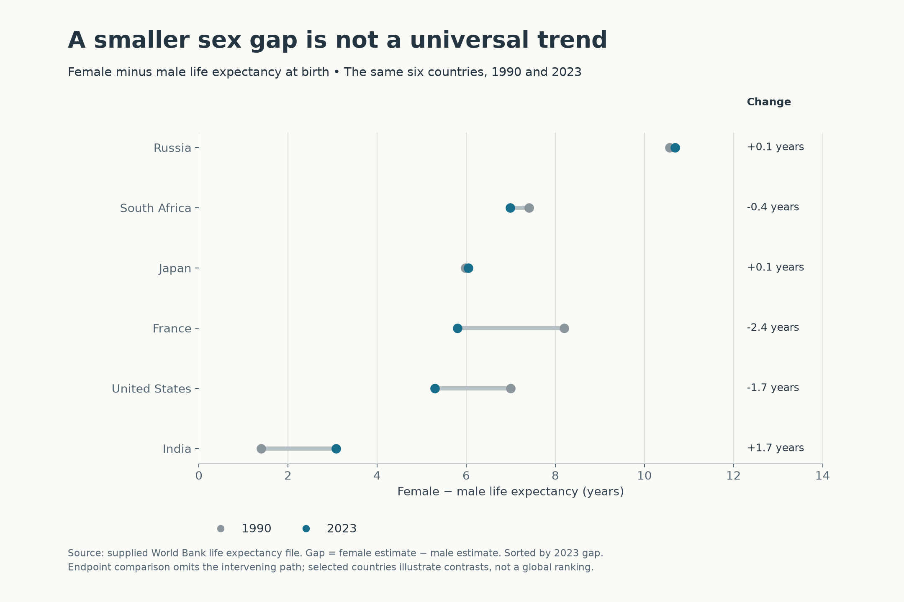
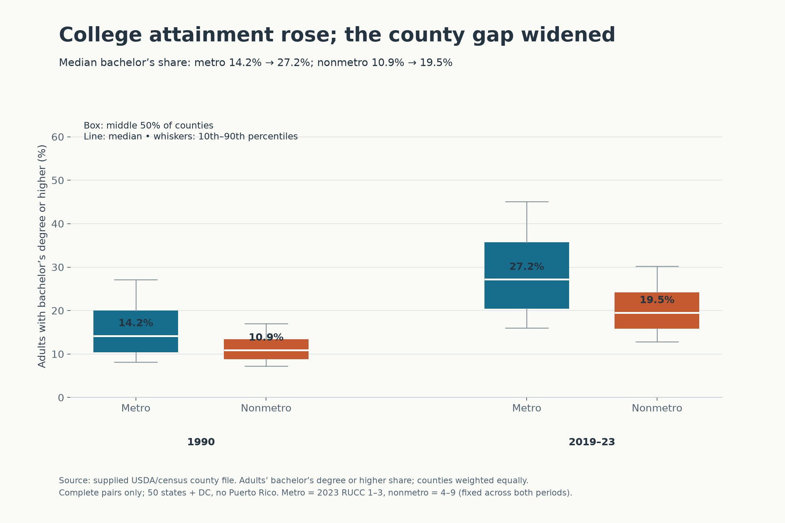
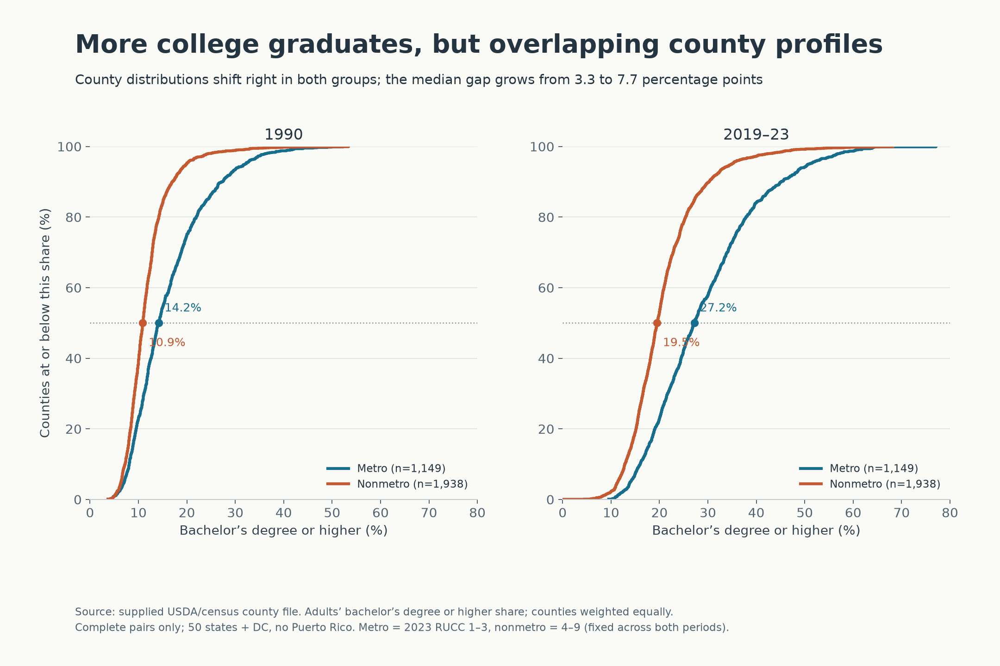
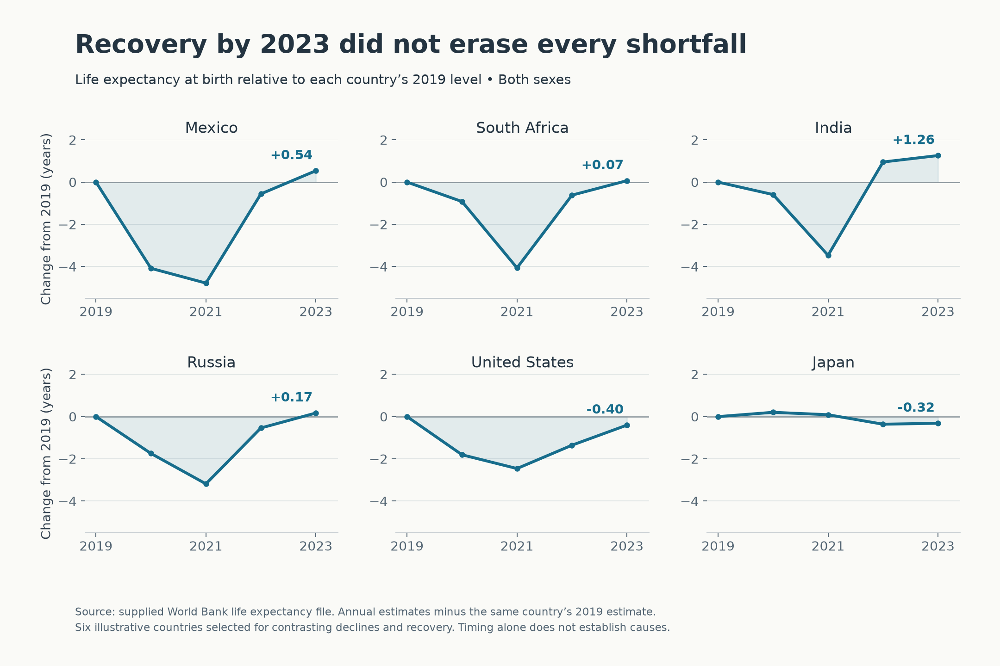
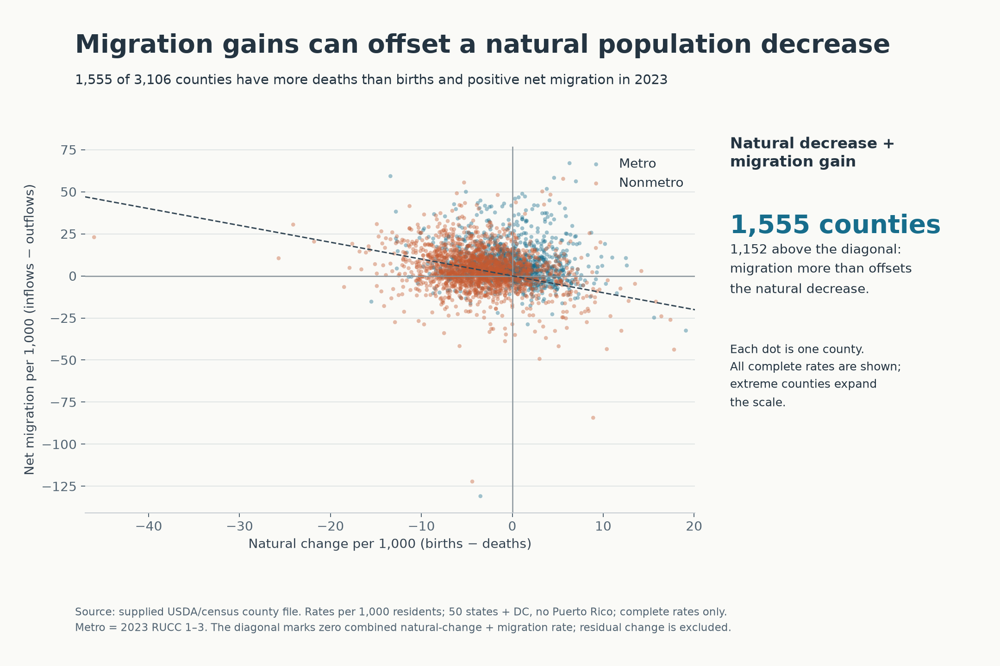

# Design Exercise 4-2 — instructor-requested example

## 1. Critique

The dumbbell design makes the range of county median incomes easy to see within each state, and the ratio labels give a second way to compare the extremes. Sorting roughly by ratio also helps the intended comparison. The main problem is the claim of “income inequality”: differences between county medians describe geographic variation, not inequality among households. A state could have similar county medians and still have substantial household inequality. The extremes also depend on the number of counties, and they hide everything between the richest and poorest county.

I would retitle it “County median household incomes vary more in some states,” label the ratio explicitly as maximum/minimum, and explain how the displayed states were selected. Horizontal dumbbells would make state labels easier to read and avoid repeating them beside the points. Adding the middle 50% of county medians would show whether a large range reflects a broad spread or just a few extreme counties. The caption should say “among the selected states” when describing the largest and smallest ratios.

## 2. Story/question 1

How did the female–male life expectancy gap change from 1990 to 2023 in six contrasting countries? France and the United States narrowed their gaps, while India’s widened and Russia’s remained large despite considerable fluctuation.

## 3. First visualization for story 1

Upload: `01-life-gap-trajectories.png`

## 4. Rationale

Small multiples let each country’s trajectory remain visible without a tangled six-line plot. All panels use the same axes, so differences in both gap size and variation are comparable. I plot female minus male life expectancy directly because the question concerns the gap, rather than making the reader subtract two curves. Endpoint dots and 2023 labels help connect the overall path to its final value. The caption explains the calculation and makes clear that these countries are illustrative rather than representative.

## 5. Second visualization for story 1

Upload: `02-life-gap-endpoints.png`

## 6. Rationale

The dumbbells put both endpoints on one common horizontal scale. Sorting by the 2023 gap makes the current differences easy to scan, while the change labels distinguish narrowing from widening. Gray marks 1990 and blue marks 2023 consistently across rows. A zero-based gap axis gives the distances a clear interpretation. I explicitly note that the endpoints leave out the intervening trajectory.

## 7. Comparison

The small multiples show when changes occurred and reveal reversals that the endpoint chart misses, especially in Russia. They require more space and more eye movement to compare countries. The dumbbells are better for comparing the size and direction of the net changes, but can suggest a smoother progression than actually occurred. I would use the first for a discussion of trajectories and the second for a compact summary.

## 8. Story/question 2

How did the distribution of county bachelor’s attainment change between 1990 and 2019–23 in metro and nonmetro counties? Both groups shifted upward, but the difference between their county medians widened from about 3.3 to 7.7 percentage points.

## 9. First visualization for story 2

Upload: `03-education-boxplots.png`

## 10. Rationale

Grouped boxplots make the two comparisons visible: change over time within each group and differences between groups within each period. Color identifies metro status, while position separates the periods. The boxes show the middle half of counties; the labeled medians state the main result without replacing the distribution. I use 10th–90th percentile whiskers to emphasize the typical range and identify that convention in the image. Each county receives equal weight, so the claim concerns county profiles rather than the share of all Americans holding degrees.

## 11. Second visualization for story 2

Upload: `04-education-cumulative.png`

## 12. Rationale

The cumulative curves retain the entire distribution instead of reducing it to a few quantiles. A rightward shift means counties generally have higher attainment, and the common scales support comparison across periods. The 50% reference line and median labels tie the more detailed distribution view to the same story as the boxplots. The legend includes sample sizes, and the caption documents the fixed 2023 metro classification and complete-pair filter.

## 13. Comparison

The boxplots communicate the widened median gap quickly and use less space. They conceal differences in the tails and the shape of each distribution. The cumulative curves let readers ask questions such as “what fraction of counties have bachelor’s attainment below 20%?” and show that the groups overlap. They take more explanation, especially because a higher curve at a given attainment threshold means more counties have relatively low attainment. For a general audience I prefer the boxplots; for a reader inspecting distributions I prefer the cumulative curves.

## 14. Story/question 3

Among six countries with contrasting recent trajectories, how far did life expectancy fall after 2019, and had it returned to its 2019 level by 2023? Recovery differed: India and Mexico ended above their baselines, while Japan and the United States remained below them.

## 15. Visualization for story 3

Upload: `05-life-recovery.png`

## 16. Rationale

Subtracting each country’s 2019 estimate creates a common baseline, so the picture compares losses and recovery rather than starting levels. Shared axes prevent a small decline from looking as large as a large one. The zero line makes “recovered to baseline” immediately visible, and the final labels show the remaining surplus or shortfall. Small multiples preserve country identities and avoid overlapping curves. These are annual estimates of life expectancy at birth, not actual lifespans of a cohort; the chart describes timing without attributing changes to a single cause.

## 17. Story/question 4

How often did positive net migration counter a natural population decrease in US counties in 2023? The scatterplot separates counties where migration only partly compensated for more deaths than births from counties where it more than offset that decrease.

## 18. Visualization for story 4

Upload: `06-migration-natural-change.png`

## 19. Rationale

The scatterplot places the two population-change components on comparable per-1,000-resident scales, avoiding a comparison dominated by county size. The zero lines distinguish the signs of each component. In the upper-left quadrant, the diagonal separates counties whose migration gain exceeds their natural decrease from those where it does not. Color supplies metro status as additional context, and small translucent points reduce overlap. The accompanying counts summarize that quadrant without asking readers to count dots. I keep all complete observations visible and state that the component sum excludes residual population change.

## 20. Tools, processing, and AI disclosure

This is a complete AI-generated example requested by the instructor for private instructional review, not a student submission. OpenAI Codex selected the stories and encodings, wrote the Python script, processed the supplied data, generated all six figures, examined the provided critique image, and drafted these responses. The wording and design decisions should therefore be attributed to the AI rather than presented as a student’s independent work.

The figures use Python in the existing `p314` environment, pandas, NumPy, and Matplotlib. No packages were installed. For life expectancy, the script pivots the supplied World Bank data by country, year, and sex, then calculates female-minus-male gaps and changes from 2019. For census data, it reads the county CSV with its actual comma delimiter and Windows-compatible encoding, excludes Puerto Rico and records without a valid 2023 rural–urban code, and classifies codes 1–3 as metro and 4–9 as nonmetro. Education uses counties with both period values and weights each county equally; the 2019–23 values are period estimates, not a single-year observation. Migration uses complete supplied 2023 rates and counts the relevant sign and component-sum conditions. The figures do not establish causality.

The supplied assignment, data documentation, grading guidance, AI policy, and critique image were read locally. No web pages were opened and no outside data were added. Scripts and derived tables are retained in `work/`; `work/README.md` explains regeneration.
