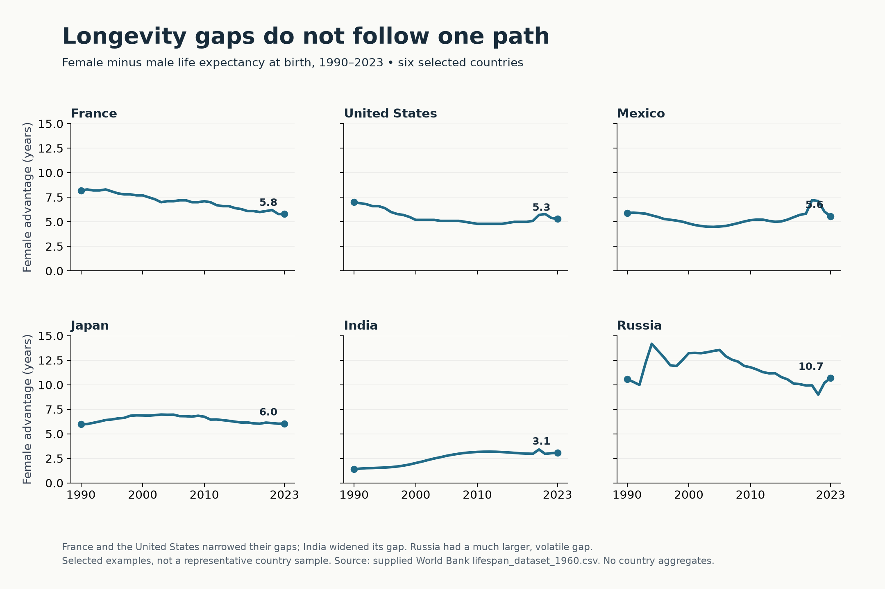
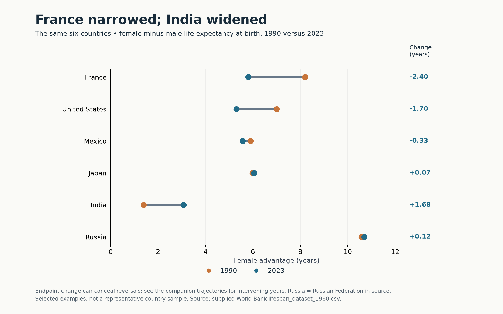
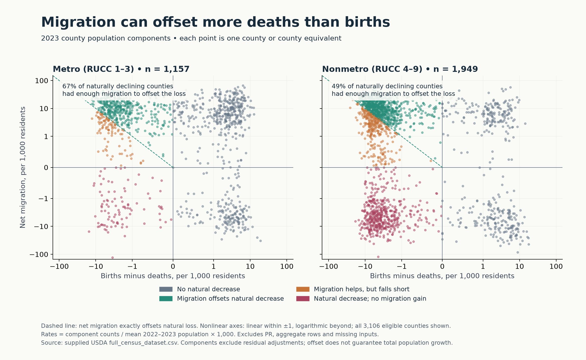
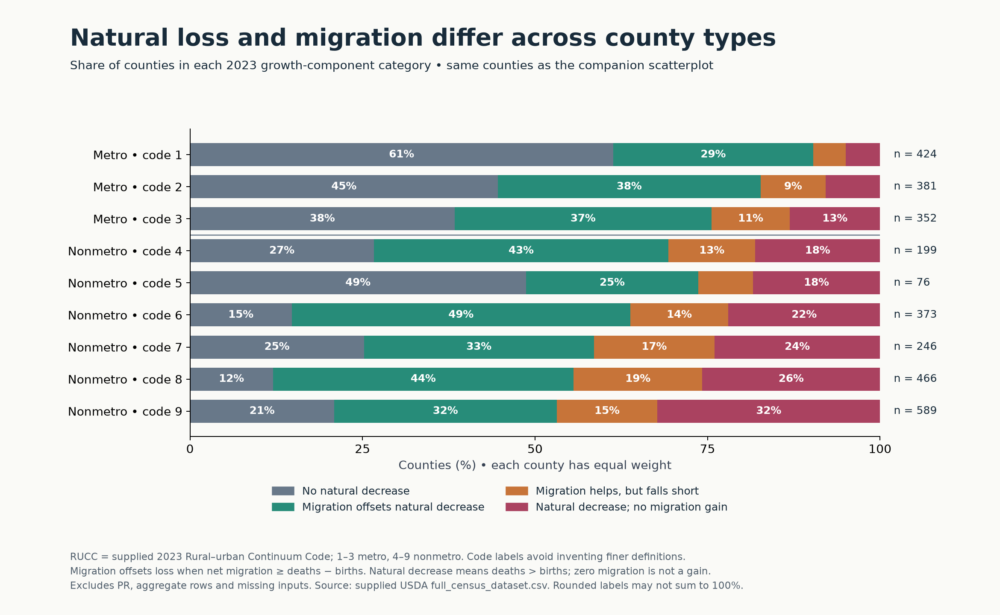
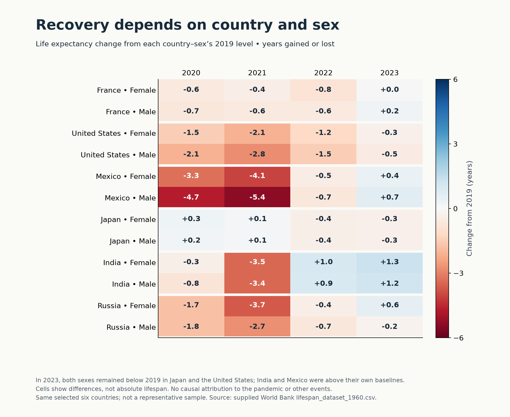
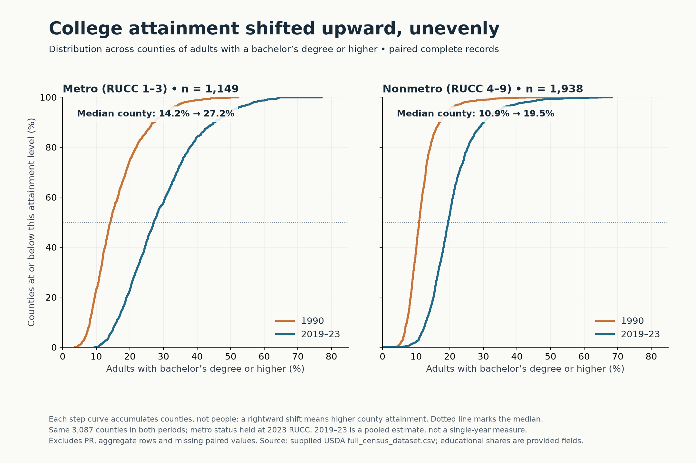

# Instructor example: Design Exercise 4-2

Prepared for private instructional review at the instructor’s request. This is an AI-created example, not a student submission. Numbering follows the saved assignment’s Canvas survey. All figures are separate, single-page PNG files.

## 1. Critique of the provided visualization

I use the non-CLO option and critique the supplied “Income inequality varies across states” figure. Its connected minimum/maximum dots are a sensible way to show the range of county median household incomes within each selected state. The restrained colors distinguish endpoints consistently, and the ratio annotations add a relative comparison beyond the dollar difference. The caption explains the underlying county summaries and acknowledges the selected-state display.

The main problem is the claim: the range of county medians is a measure of between-county disparity, not overall household income inequality within a state. It omits differences among households within each county and is sensitive to extreme counties and the number of counties in a state. The title and claims about “lowest” and “highest” inequality therefore promise more than this measure supports. A better title would be “County median incomes span different ranges across selected states.” The source, selection rule and ratio definition should be stated explicitly, and the axis should say dollars. The state's repeated labels are redundant; moving state names to a single aligned axis would improve scanning. The order also does not consistently follow the printed ratios: California’s 2.77 precedes Alabama’s 2.83, but New York’s 2.90 follows it. I would sort by max/min ratio if relative disparity is the task, and state that rule. A horizontal arrangement would make labels easier to read. I would identify the counties supplying each extreme, and qualify the discussion as a comparison of selected states. If the intended subject truly is household inequality, this figure alone cannot answer it.

## 2. Story / Question 1

How did the female–male life expectancy gap evolve from 1990 to 2023 in France, the United States, Mexico, Japan, India and Russia, and how much of that evolution is hidden by comparing only endpoints? France and the United States narrowed their gaps, India widened its gap, and Russia’s modest endpoint change conceals substantial volatility.

## 3. First visualization for Story 1

Upload: `figures/01-life-gap-trajectories.png`

## 4. Rationale for Story 1, first visualization

I subtract male from female life expectancy at birth for each country-year, so vertical position directly answers the gap question. Six small multiples prevent overlapping country lines and allow each trajectory to be followed without a color lookup. Shared 0–15-year axes make gap levels and fluctuation magnitudes comparable; zero retains the meaning of no female advantage. Endpoint dots and the labeled 2023 values give anchors without cluttering every year. The sequence groups three narrowing examples before stable/widening examples and ends with the most volatile trajectory. Country, sex and year all enter the analysis. These countries were deliberately chosen to contrast observed paths; the caption prevents generalizing this selection to the world. Russia’s intervening spike makes the value of the time series particularly clear.

## 5. Alternate visualization for Story 1

Upload: `figures/02-life-gap-endpoints.png`

## 6. Rationale for Story 1, alternate

The horizontal dumbbell chart uses position on one shared scale to compare the 1990 and 2023 gaps. Orange and blue consistently identify years; connector lengths make differences visible while signed labels quantify changes, including changes too small to distinguish easily by eye. Using the same country order as the first figure helps a reader move between designs. France’s −2.40-year change and India’s +1.68-year change are immediately apparent. A zero-based gap axis avoids exaggerating near-overlapping points. The caption explicitly warns that these endpoints can hide reversals.

## 7. Comparison of Story 1 designs

The small multiples show the shape and timing of change: Russia’s large intermediate gap and Mexico’s temporary widening are visible. Their shared axes support cross-country comparison, but estimating an exact net change requires comparing distant endpoints. The dumbbell chart is faster for comparing starting/ending levels and net changes, with precise labels available. It is also more compact. Its cost is the loss of all intervening years: Russia looks nearly unchanged even though its trajectory is not stable. I would use the first for a discussion of historical patterns and the alternate for an endpoint summary, retaining its limitation in the caption.

## 8. Story / Question 2

In 2023, how often did net migration offset a county’s natural population decrease, and how did that pattern differ between metro and nonmetro counties and across rural–urban codes? Among counties with more deaths than births, migration offset the natural loss in about 67% of metro counties versus 49% of nonmetro counties.

## 9. First visualization for Story 2

Upload: `figures/03-county-migration-scatter.png`

## 10. Rationale for Story 2, first visualization

The scatterplot combines natural change and net migration in two positional encodings. Rates per 1,000 residents let very differently sized counties share a plot. Separating metro (RUCC 1–3) from nonmetro (4–9) avoids relying on point color to distinguish geography; color instead represents the four substantive component categories. The zero lines identify natural decline and migration loss. The dashed boundary in the upper-left quadrant identifies the exact point where migration compensates for natural loss. This makes the classification interpretable from the plotted variables rather than just from a legend.

Small transparent points retain 3,106 eligible counties and show density approximately; they are not intended to support exact counting. The symmetric-log axes preserve large positive and negative outliers while opening up the crowded region near zero. Their nonlinear scale is disclosed, with explicit ticks and a linear region within ±1. The annotations provide the exact count-based comparison that overlapping points cannot. Rates use the mean of 2022 and 2023 population estimates, while categories use unrounded component counts. This is descriptive: compensating for natural loss in these two components does not necessarily mean positive total population change, because residual adjustments are not included.

## 11. Alternate visualization for Story 2

Upload: `figures/04-county-migration-shares.png`

## 12. Rationale for Story 2, alternate

The 100% stacked bars replace individual points with the share of counties in each component category. Nine rows retain the supplied rural–urban codes, ordered numerically and separated between metro and nonmetro, rather than pooling all nonmetro counties. The same colors and rules as the scatterplot make the two views coherent. A common left edge makes the “no natural decrease” share easy to compare; the green segment then shows counties whose migration offsets their natural loss. Printed percentages reduce the difficulty of comparing segments with different baselines. Small segments remain visible even where there is insufficient room for a label. Sample sizes expose unequal group counts. The denominator is all eligible counties within each code, not the population living in those counties and not only naturally declining counties.

## 13. Comparison of Story 2 designs

The scatterplot shows the magnitude and combinations of the two components, including outliers and whether positive migration almost or greatly exceeds natural loss. It requires understanding a nonlinear scale, and overlap makes category frequencies hard to judge. The stacked bars provide a cleaner count-based summary and expose heterogeneity within nonmetro codes, but discard rate magnitudes: a barely compensating county and one with a large migration surplus count equally. Interior segments also lack a common baseline. The annotations on the scatterplot use naturally declining counties as their denominator; the bars use all counties within each code. These are complementary summaries of the same records, with their denominators explicitly distinguished.

## 14. Story / Question 3

In the same six selected countries, how did female and male life expectancy in 2020–2023 compare with each sex’s 2019 baseline? By 2023, both sexes were still below baseline in Japan and the United States, while both were above baseline in India and Mexico.

## 15. Visualization for Story 3

Upload: `figures/05-life-recovery-heatmap.png`

## 16. Rationale for Story 3

A country–sex-by-year heatmap makes the cross-classification compact and keeps female and male rows adjacent. Each cell is that series’ life expectancy minus its own 2019 value, so countries with different absolute lifespans are compared on recovery relative to their baseline. Red means below baseline and blue means above; a single diverging scale centered on zero avoids implying different meanings of color across rows. Signed numeric values make small changes legible even when the color is nearly neutral. Separators preserve country grouping. Mexico’s especially large male decline in 2021 and its above-baseline 2023 values can be compared with the persistent U.S. shortfall. The caption explains that this chart is about differences, not absolute lifespan, and does not attribute the changes causally to the pandemic. Display values are rounded to one decimal; a displayed +0.0 is approximately zero, not evidence of a substantial gain.

## 17. Story / Question 4

How did the county distribution of bachelor’s-or-higher attainment shift from 1990 to 2019–23, and did metro and nonmetro counties shift similarly? Both distributions moved toward higher attainment, but the median metro county increased from 14.2% to 27.2%, compared with 10.9% to 19.5% for the median nonmetro county.

## 18. Visualization for Story 4

Upload: `figures/06-education-distributions.png`

## 19. Rationale for Story 4

Empirical cumulative distribution curves show the entire distribution instead of only a mean or selected counties. At any attainment threshold, vertical position gives the percentage of counties at or below it. The later curve’s rightward displacement therefore indicates higher attainment across much of the distribution. Matched scales across metro/nonmetro panels make both the level difference and the change visible. A dotted 50% line and explicit medians support readers unfamiliar with cumulative curves. The period colors are consistent with the first story’s endpoint chart. I keep only the 3,087 counties with both education values, so a changed set of records cannot explain the shift, and hold the metro/nonmetro classification at its supplied 2023 value. Each county receives equal weight; this is not the distribution of individual adults or a national attainment rate. The recent observation is a 2019–23 pooled estimate, not a single-year measurement. Holding current classifications fixed also does not establish that a county had the same metro status in 1990.

## 20. Tools, processing and AI disclosure

This is an instructor-requested example produced by OpenAI Codex for private instructional review. Codex selected the stories and country examples, wrote and executed the plotting/data-processing script, generated all six figures, inspected their layouts, and wrote the critique, rationales and comparisons. The AI contribution includes the substantive analysis and design decisions, not merely editing or programming assistance. No student authorship or participation in the CLO is claimed. The instructor supplied the task, authorization, saved references and datasets; independent instructor review is still appropriate before using this as teaching material.

Tools: Python 3.14 in the existing `p314` environment (`/opt/anaconda3/envs/p314/bin/python`), pandas for loading/filtering/reshaping data, NumPy for derived arrays and classifications, Matplotlib for static figures, and Pillow for a local contact-sheet layout check. Standard-library pathlib, os and json handle paths, cache configuration and summary output. No packages were installed, no new environment was created, and no toolchains were changed. Shell commands were used to read saved materials and create the requested files. No web pages were opened or external data added.

Life expectancy: I used only `lifespan_dataset_1960.csv`, selected six named countries, pivoted country/year/sex rows, and computed female minus male gaps or sex-specific changes from 2019. The first pair uses 1990–2023; the recovery heatmap uses 2019 as baseline and 2020–2023 as displayed years. “Russia” abbreviates the source’s “Russian Federation.” The examples were selected for contrasting observed patterns, not as a representative sample, and regional/income aggregates were not included.

Census: I decoded `full_census_dataset.csv` as Windows-1252, preserved FIPS as strings, excluded Puerto Rico and aggregate FIPS rows, and retained supplied 2023 RUCC codes 1–9. This yields 3,106 eligible county/county-equivalent rows; all have the inputs needed for the growth figures. I calculate component rates as the 2023 count divided by mean 2022/2023 population, multiplied by 1,000. Categories are: natural change ≥0; natural change <0 with net migration ≥−natural change; natural change <0 with 0<net migration<−natural change; and natural change <0 with net migration ≤0. All classification comparisons use unrounded counts. Code bars count counties equally, and scatter annotations divide offset counties by naturally declining counties in each metro group. Components omit residual adjustments.

For education, I use the supplied bachelor’s-or-higher percentages, omit 19 eligible counties missing either period, and form cumulative distributions and medians from the remaining paired 3,087 records. County identity is the supplied record/FIPS; no attempt was made to reconcile historical boundary changes. No imputation, population weighting, external joins or causal modeling was performed. The supplied merged file’s coverage and historical boundary limitations remain limitations of this example.

The reproducible script, intermediate tables, numerical summary and regeneration instructions are in `work/`. The script draws every graphic element; no manual illustration or image editing is needed.
