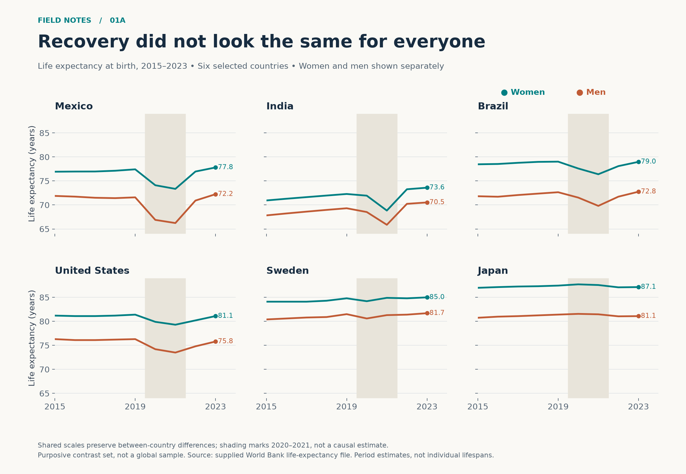
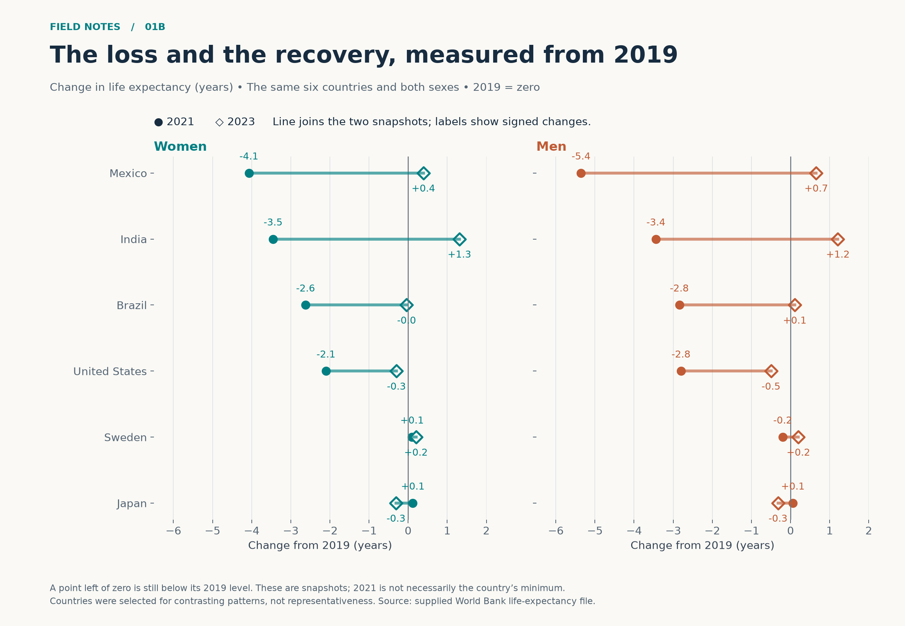
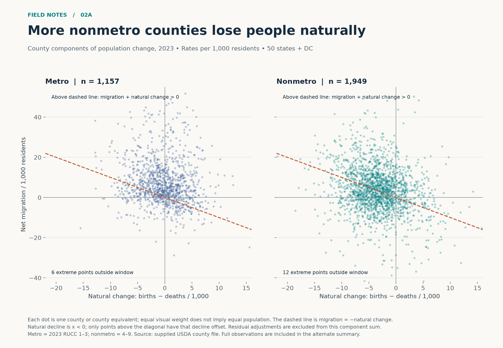
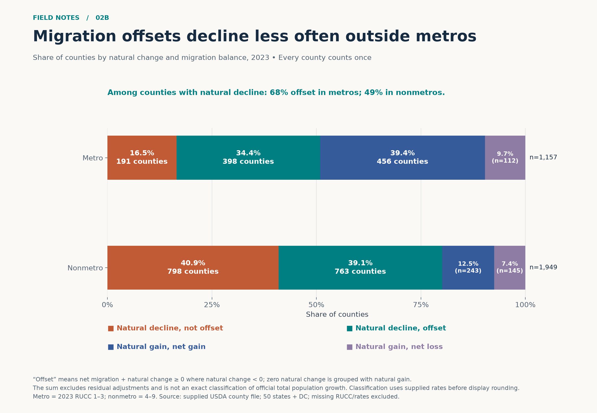
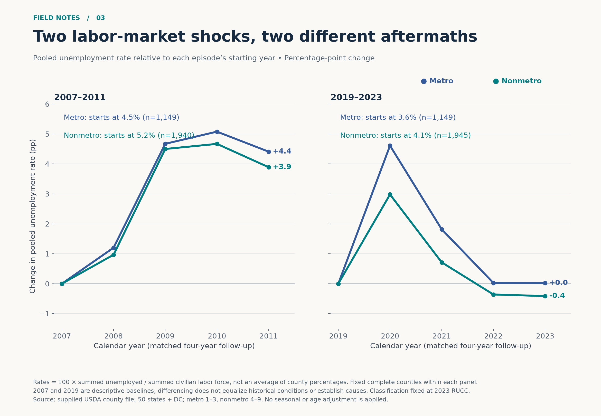
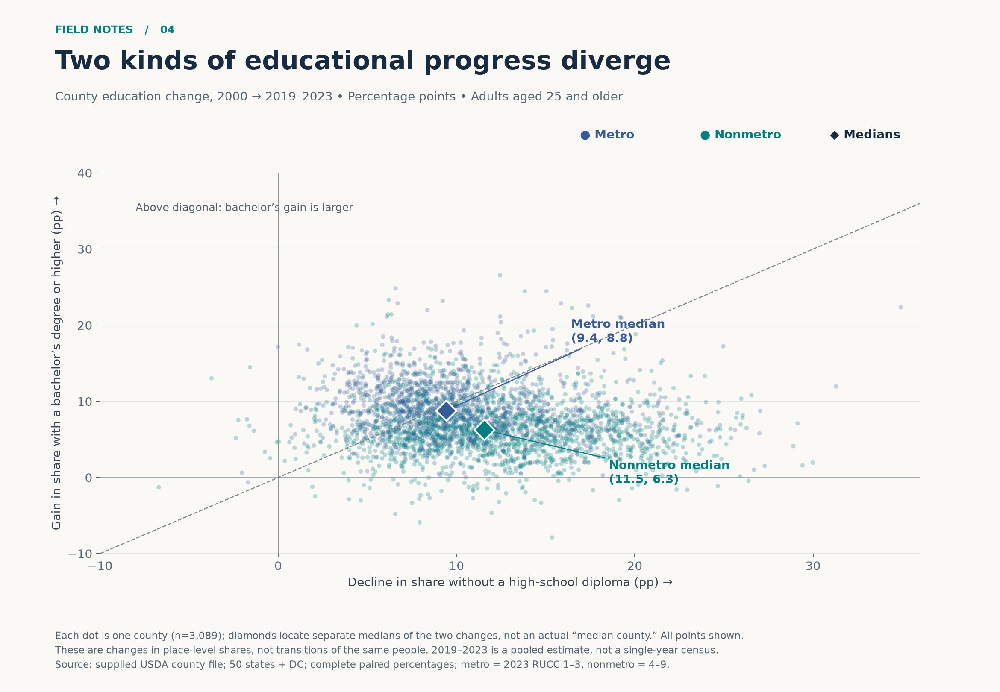

# Instructor example — private instructional review

This is an AI-created example for an instructor, not a student submission. Numbers below are descriptive estimates from the supplied files. The six PNG files are the upload versions; SVG versions are supplied for resolution-independent viewing.

## 1. Critique of the supplied design

The dumbbell chart makes the contrast between each state's highest and lowest county median household income easy to see. Using positions on a shared dollar axis is appropriate, and the connecting lines help pair the two values. The caption identifies the county-level aggregation, while ratio labels add a second way of comparing gaps. The blue/orange distinction is redundant with the endpoints' vertical order, which supports accessibility.

Its main weakness is the claim. A ratio of two county medians describes **between-county extremes**, not household income inequality within a state. A state could have very similar county medians and still have substantial inequality among households. “WY has the lowest income inequality” is therefore not supported by this statistic. A more precise title would be “The spread between county median incomes varies across selected states.” The ratio is the maximum divided by the minimum, not “times larger,” a phrase that can ambiguously imply an additional multiple.

The states appear ordered by their ratios, but the chart never explains that ordering. Label it explicitly. The plotted line lengths encode dollar differences, while the annotations and sorting emphasize ratios; those can produce different rankings. Two aligned panels—county income ranges and maximum/minimum ratios—would separate those tasks. I would use horizontal ranges so full state names and, ideally, the two endpoint county names fit comfortably. Replace “Measure Names” with “County median household income,” and identify the year, dollars, source, and scope in a compact subtitle.

The caption's top/bottom five plus six selected states is transparent but creates a selected comparison, not a complete ranking. State that prominently, explain the discretionary selection, and do not imply that every state is visible. Extrema also hide county counts and all intermediate values: a state with many counties has more opportunities to exhibit a large range. A faint distribution of county medians or an interquartile interval would give context. The design is effective for its narrow range-comparison task; its interpretation needs to match that task.

## 2. Story / Question 1

Across six deliberately contrasting countries, how did women's and men's life expectancy change during 2020–2021, and had each returned to its 2019 level by 2023? Mexico, India, Brazil, and the United States show substantial 2021 losses, but their 2023 recovery patterns differ; Japan and Sweden provide useful contrasts.

## 3. First visualization for Story 1

Upload **figures/01a_life_trajectories.png**.

## 4. Rationale for Story 1, primary

Six small multiples combine country, year, sex, and life expectancy without turning twelve series into a tangled single plot. Identical year and life-expectancy scales preserve honest between-country comparisons. Each country has only two directly associated colored series; the repeated mapping—teal women, rust men—allows the viewer to scan for sex differences. Thin horizontal guides support numerical reading, and labels on the 2023 endpoints supply the actual levels.

The shaded 2020–2021 interval directs attention to the requested period without drawing a causal conclusion. Showing 2015 onward provides pre-period context and makes clear that 2021 and 2023 are parts of trajectories rather than isolated measurements. Mexico's male series, for example, visibly falls more than its female series. Japan's late decline and Sweden's relatively stable trajectories also demonstrate why a universal “2021 trough” claim would be inappropriate.

The contrast set is purposive, not a random or global sample. This limitation appears in the image itself. The shared vertical scale is a tradeoff: it preserves absolute levels but makes Sweden's small movements harder to inspect. The alternate directly addresses that reading task.

## 5. Second visualization for Story 1

Upload **figures/01b_life_recovery.png**.

## 6. Rationale for Story 1, alternate

This design changes the task from following full trajectories to assessing loss and recovery. I subtract each country's own 2019 value separately for women and men. A common zero line then answers “back to baseline?” without asking the reader to mentally compare different absolute levels. Filled circles show 2021 and hollow diamonds show 2023; shape, position, and the caption identify the snapshots, so timing does not depend on color alone. Horizontal connectors show the displacement between them, and signed one-decimal labels reveal direction and magnitude.

The same countries retain the same order as the primary. Separate aligned panels use sex color consistently and make cross-sex comparisons straightforward. Mexico's male change is about −5.4 years in 2021 but +0.7 by 2023. US men are about −2.8 and −0.5, respectively. Japan is slightly below its 2019 level in 2023 despite its 2021 estimates remaining above baseline. The caption explicitly warns that 2021 need not be the minimum: the marks are snapshots, not an inferred trough and recovery duration.

## 7. Compare the Story 1 designs

The primary gives absolute levels, sex gaps, pre-period context, and the shape of intervening changes. It shows, for example, that Japan's life expectancy remains much higher than Mexico's even though Japan's 2023 value is below its own baseline. Its weakness is the difficulty of measuring small changes on a broad common scale.

The alternate makes the exact loss and remaining deficit immediately comparable and foregrounds countries that exceeded their own baselines. It discards absolute levels and intervening years; the connector should not be interpreted as a linear recovery. For a reader asking whether recovery was complete, the alternate is stronger. For a reader asking how trajectories and sex gaps evolved, the primary is stronger. Both tell the same story with a different reading task.

## 8. Story / Question 2

In 2023, how often did net migration offset a county's excess of deaths over births, and how does this balance differ between metro and nonmetro counties? Among natural-decline counties, migration offsets that decline in 398 of 589 metro counties (67.6%) and 763 of 1,561 nonmetro counties (48.9%). The analysis compares natural-change and net-migration components, not official total population change including residual adjustments.

## 9. First visualization for Story 2

Upload **figures/02a_migration_balance.png**.

## 10. Rationale for Story 2, primary

The horizontal axis places births minus deaths alongside the vertical net-migration axis, with both expressed per 1,000 residents. This avoids comparing raw counts across counties of radically different population sizes. The diagonal represents net migration = minus natural change; above it, the two components sum to a positive number. A county with natural decline lies left of the vertical zero line, so the upper-left region above the diagonal is the specific “offset” pattern.

Metro and nonmetro panels use identical scales, making their distributions comparable. Small, transparent, equally sized points reveal concentrations without letting the largest counties dominate. Faceting avoids heavy color overlap and puts metro status in the title. The plotted windows deliberately favor the bulk of counties; each panel explicitly reports how many extreme observations lie outside it. Their removal from this view is not removal from the analysis: the alternate includes all complete observations. The image defines the component sum, metro grouping, population-rate units, geographic scope, and source.

## 11. Second visualization for Story 2

Upload **figures/02b_migration_shares.png**.

## 12. Rationale for Story 2, alternate

A 100% stacked comparison makes the prevalence of the four component-balance outcomes explicit. A separate callout reports the conditional offset shares among natural-decline counties; these use a different, clearly stated denominator from the bars. Rust and teal identify natural-decline counties that were, respectively, not offset and offset by migration. Blue and muted purple identify natural-gain counties with a nonnegative or negative component sum. Group sample sizes and counts supplement percentages so readers can distinguish the larger number of nonmetro counties from the share within each group.

Every complete county receives equal weight. This answers a question about counties, not the share of the national population living in each outcome. The classification uses the full file, including scatterplot outliers. Its boundaries are stated precisely: natural decline means strictly negative natural change; an offset includes a component sum of exactly zero. Zero natural change is grouped with natural gain, as disclosed in the image. The prominent title is deliberately about metro status and county shares, rather than claiming migration caused growth.

## 13. Compare the Story 2 designs

The scatterplots retain magnitudes and reveal how narrowly or decisively migration offsets natural decline, together with outliers and the spread within each group. Estimating exact category proportions from overlapping dots is difficult, and the viewing window excludes the most extreme points with an explicit count.

The stacked chart is better for the prevalence comparison and includes every usable observation. It loses the rates: a county barely above the balance line and one far above it receive the same category. Middle segments also lack a common baseline, so the scatterplot remains helpful when readers want to investigate the mechanism behind the percentages. These are complementary encodings of the same two-component balance.

## 14. Story / Question 3

For metro and nonmetro counties, how did pooled unemployment change over equally long four-year follow-up windows starting in 2007 and 2019? The early 2020s spike reverses much faster within the observed window than the late 2000s increase.

## 15. Visualization for Story 3

Upload **figures/03_unemployment_aftermaths.png**.

## 16. Rationale for Story 3

Two aligned panels compare the same length of follow-up rather than unmatched historical episodes. Each group's rate is centered on its own starting year, so vertical position measures percentage-point change rather than mixing initial unemployment levels with the shock. Starting rates are printed separately to preserve that context. A common scale supports comparing magnitude and persistence; a zero reference makes return to baseline explicit. Only two group lines per panel prevent clutter, and endpoint labels report the final difference.

Rates are calculated by dividing summed unemployed people by summed civilian labor-force counts, not by averaging county rates. Thus the rate represents the pooled labor force in eligible counties. Within each panel I keep a fixed complete county set over all five years, preventing missing-data changes from manufacturing a trend. The county set can differ between episodes and is documented through sample-size labels. Metro status is held at its 2023 classification for every year; this enables stable comparisons but does not reproduce historical urbanization categories. The design is descriptive, with no claim that the crises alone explain the differences.

## 17. Story / Question 4

Between 2000 and the 2019–2023 estimate, did reductions in the share of adults without a high-school diploma coincide with equally large gains in bachelor's attainment? Both outcomes usually improve, but metro counties show larger median bachelor's gains, while nonmetro counties show larger median declines in low educational attainment.

## 18. Visualization for Story 4

Upload **figures/04_education_two_changes.png**.

## 19. Rationale for Story 4

A bivariate change plot makes two forms of educational progress independently visible. I reverse the subtraction for the horizontal variable—old minus new—so movement right means less exclusion, while movement up means more bachelor's attainment. Both axes are percentage points, making the diagonal a meaningful equality reference. The positive upper-right region shows improvement on both measures; the diagonal distinguishes which change is larger.

Every paired county appears as a small translucent dot. Metro color and nonmetro color expose broad overlap as well as differences; labeled diamonds locate each group's separate marginal medians. The opposite ordering of the group medians on the two axes supports the story without pretending that every metro county outperformed every nonmetro county. The image cautions that a pair of medians need not correspond to an actual county.

These are two cross-sectional descriptions of places, not matched people. Changing shares can reflect migration, cohort replacement, boundary changes, and attainment. Neither axis represents the number of people who progressed from one education category into another. The later value is a pooled 2019–2023 estimate, clearly distinguished from the 2000 observation.

## 20. Tools, processing, and AI disclosure

This instructor-requested example was created by **OpenAI Codex**, an AI agent. The AI selected the stories, explored the supplied data, designed the figures, wrote and ran the code, inspected visual output, and wrote the critique and all rationales. No human authorship of these choices is implied. The instructor should independently review this example before instructional use.

Tools: the existing `p314` Python 3.14 environment at `/opt/anaconda3/envs/p314/bin/python`, pandas for reading/filtering/reshaping and numerical summaries, NumPy for transformations, Matplotlib for static PNG and SVG rendering, Pillow for a visual-review contact sheet, Python's pathlib/json/os modules for files, and shell commands for execution. No packages were installed, toolchains changed, or external data added. The supplied assignment, rubric, dataset descriptions, AI policy, and critique image were read locally; no pages were opened online.

The World Bank analysis filters named country codes MEX, IND, BRA, USA, SWE, and JPN and Female/Male series for 2015–2023. It calculates separate 2019-relative differences for 2021 and 2023. Regional aggregate rows never enter these six-country comparisons. Life expectancy is a period estimate at birth, not observed average age at death or a prediction of any individual's lifespan.

The county file is read using Windows-1252 to accommodate its existing encoding. FIPS values identify counties; state summary identifiers divisible by 1,000 and Puerto Rico are excluded. County equivalents in the 50 states and DC remain eligible. Valid 2023 Rural–urban Continuum Codes define metro (1–3) and nonmetro (4–9), with missing classifications excluded. Migration uses complete natural-change and net-migration rates; their sum excludes residual population adjustments. Education uses complete paired attainment percentages. The unemployment calculation uses complete labor-force and unemployment counts within each five-year episode and pools the counts before division. Education and migration descriptions give every county equal weight; unemployment gives labor-force counts their proper weight. No county population weighting was silently used for county-share comparisons.

All six figures are generated from `work/make_figures.py`; their calculation tables, summary statistics, and working files remain in `work/`. The README gives regeneration instructions. The PNGs are single-page images with titles, units, definitions, source notes, and interpretation limits. The alternatives use different encodings, while the remaining figures extend the portfolio to matched time-series comparisons and bivariate change.
