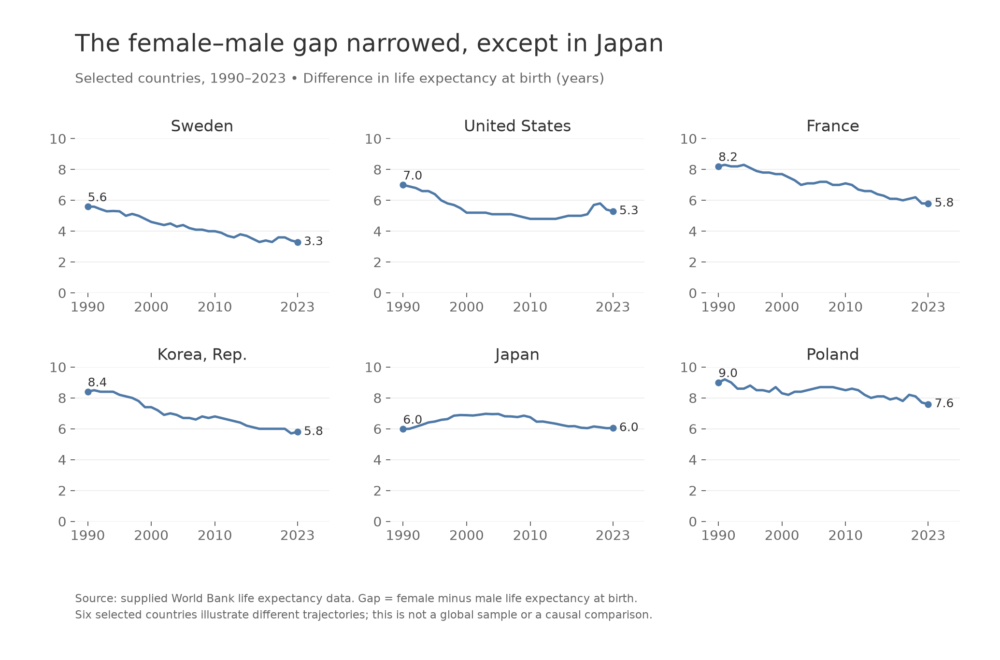
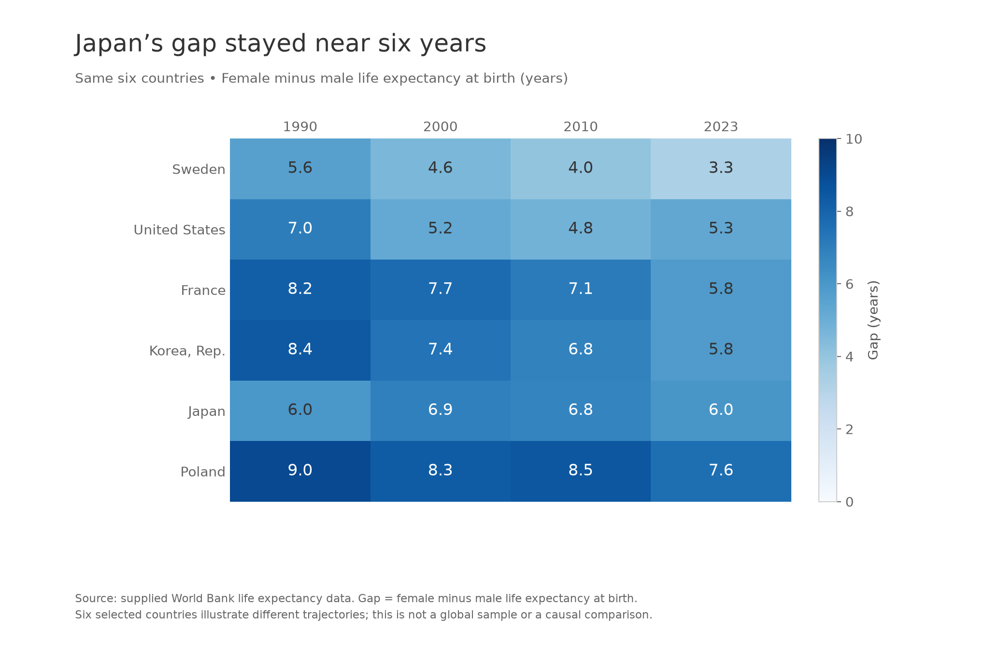
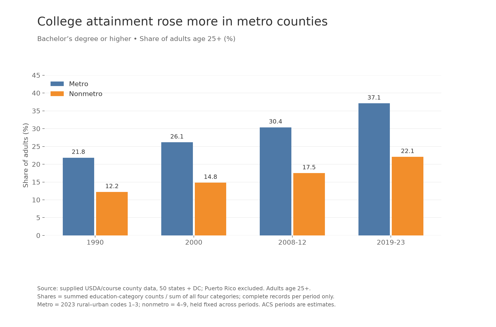
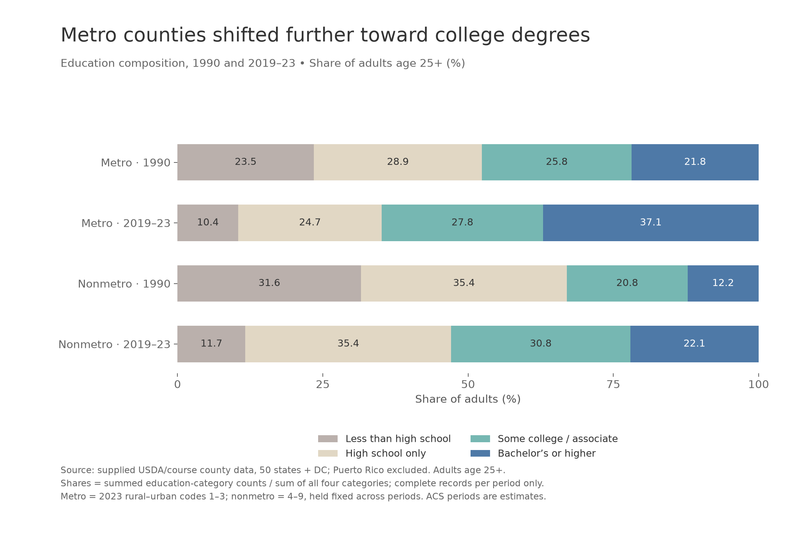
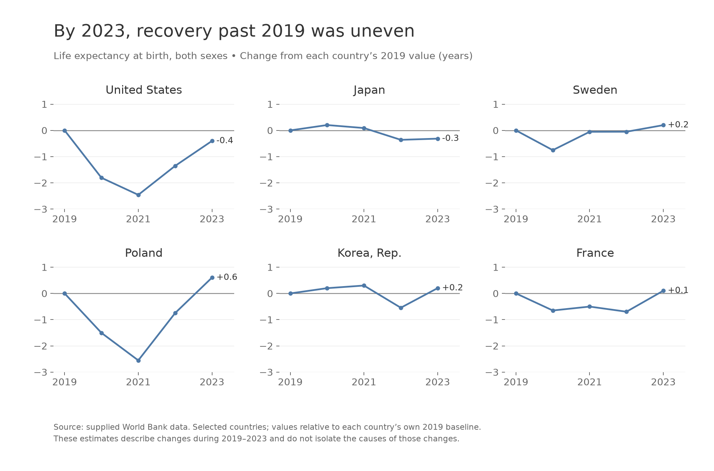
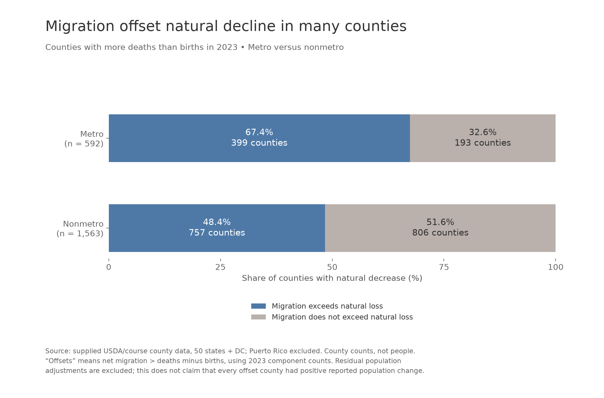

# Instructor-requested example — Design Exercise 4-2

## 1. Critique

This response uses the supplied critique image rather than the collaborative learning option. The connected endpoints make each state’s county-income range easy to see, and the blue/orange distinction is consistent with the legend. Ratio labels add information that the dollar difference alone cannot provide. The caption explains the endpoints and acknowledges that only selected states are shown.

The title overstates the evidence: variation between the highest and lowest county median household incomes is not a measure of household income inequality within a state. It ignores the distribution within each county, county populations, and all counties between the extremes. Similarly, the caption’s “lowest” and “highest” claims should either be restricted to the displayed states or supported by a clearly stated ranking across all states. The selection of “additional interested states” is not explained. The states appear ordered by their max/min ratios, which aids comparison, but the sorting rule should be stated. The chart also uses “State” as a column heading even though the state labels are repeated at the endpoints, and its generic “Measure Names” legend is less helpful than “County median income endpoints.”

I would retitle it “County median household incomes span different ranges across selected states,” label dollars explicitly, and explain the state selection. I would retain the ratio-based ordering, use one set of state labels, and define the ratio in the caption. If the intended question really concerns income inequality, this dataset and these extrema alone cannot establish that conclusion.

## 2. Story / Question 1

How did the female–male life expectancy gap change from 1990 to 2023 in six selected countries? It narrowed in Sweden, the United States, France, South Korea, and Poland, while Japan’s endpoint gap remained close to six years.

## 3. First visualization for Question 1

Upload: `figures/01_life_gap_lines.png`

## 4. Rationale

Each country occupies a separate pane, with year on the horizontal axis and female minus male life expectancy on the vertical axis. The common 0–10-year scale supports comparisons of magnitude across panes. One blue line per pane avoids the overlapping lines and six-item legend of a combined chart. Endpoint labels connect the overall claim to numerical evidence, while annual observations show departures from a steady decline: Japan’s gap first increased, and the US gap rose again near the end. The countries were deliberately selected to illustrate different patterns, rather than presented as a representative world sample. The caption identifies that limitation and the source.

## 5. Second visualization for Question 1

Upload: `figures/02_life_gap_highlight_table.png`

## 6. Rationale

Country names form rows and four selected years form columns. A single sequential blue scale encodes gap magnitude, while printed numbers provide exact one-decimal comparisons without tooltips. The zero-to-ten-year legend matches the line charts’ scale. Rows run from smaller to larger 2023 gaps, keeping both designs in the same country order. This arrangement makes it easy to scan across Japan’s row and contrast its nearly equal endpoints with the lighter 2023 cells elsewhere. The four years reduce visual density while retaining intermediate checkpoints; the caption states that these are selected countries.

## 7. Comparison of Question 1 designs

The line charts are stronger for understanding trajectories: they preserve every annual observation and reveal temporary increases or reversals. Their common positional scale supports magnitude comparisons, although readers must move between panes. The highlight table is more compact and stronger for looking up values or comparing countries at a specified checkpoint. Its color pattern reinforces the overall narrowing, but color is less precise than position, so the numbers are necessary. Sampling four years hides annual fluctuations and could make a complicated trajectory look simpler. I would use the line charts as the primary explanation and the table for a reader comparing particular values.

## 8. Story / Question 2

Did the bachelor’s-or-higher share of adults grow equally in metro and nonmetro counties between 1990 and 2019–23? Both increased, but the metro share rose about 15.2 percentage points versus 9.9 points in nonmetro counties, widening the gap from 9.6 to 15.0 points.

## 9. First visualization for Question 2

Upload: `figures/03_college_grouped_bars.png`

## 10. Rationale

Adjacent metro and nonmetro bars make the place comparison explicit within each period. Repeated blue and orange identify the groups consistently, and the zero baseline makes bar lengths meaningful. Direct one-decimal labels show the numerical size of the widening gap. Periods appear chronologically as evenly spaced categories, rather than pretending that the multi-year ACS estimates are single-year observations. I calculate each share from summed education counts across counties, rather than taking an unweighted average of county percentages. This lets large and small counties contribute according to the number of adults represented. The caption identifies the population, exclusions, missing-record handling, and fixed 2023 classification.

## 11. Second visualization for Question 2

Upload: `figures/04_education_stacked_bars.png`

## 12. Rationale

Four 100% stacked bars compare the endpoints for each place group and show where college attainment fits within the full education distribution. The categories have a meaningful progression from less than high school to bachelor’s or higher. The bachelor’s category is blue and placed at the right end of every bar, giving it a common 100% reference edge. Printed shares make that comparison possible without interaction. The other colors are subdued so the college category remains prominent. The fixed total prevents the larger metro adult population from dominating the display. The composition also shows that high-school-only attainment remained near 35.4% in nonmetro counties while the metro share declined.

## 13. Comparison of Question 2 designs

The grouped bars focus directly on the requested college comparison and include two intermediate periods. They make the metro/nonmetro gap easier to compare and offer more evidence that it widened over time. The stacked bars provide context: rising college shares occurred alongside shifts among other education categories. They omit intermediate periods, and the interior categories lack a shared baseline, making their lengths harder to compare. The college segment’s common right edge helps, but the grouped bars are still the clearer primary view of the degree-attainment gap. Neither design follows the same individuals, and neither establishes why attainment changed.

## 14. Story / Question 3

By 2023, had life expectancy returned to its 2019 level in the same six countries? The United States and Japan remained below their own baselines, while Sweden, Poland, South Korea, and France were above them.

## 15. Visualization for Question 3

Upload: `figures/05_life_recovery.png`

## 16. Rationale

Subtracting each country’s own 2019 value changes the comparison from absolute longevity to recovery relative to a baseline. A horizontal zero reference line answers the question directly: points above it exceed 2019, and points below it fall short. Small multiples use identical axes, so the depth and timing of declines remain comparable. Annual markers avoid suggesting additional observations, and signed 2023 labels make the final outcome explicit. The countries appear in a deliberate order beginning with the two below-baseline cases. Keeping the same selection as Question 1 allows the two life expectancy stories to complement each other. Both-sex estimates are used here; this is a different question from the sex gap. The caption avoids attributing the entire change to any one cause.

## 17. Story / Question 4

Among counties with more deaths than births in 2023, how often did net migration outweigh that natural loss? It did so in 67.4% of metro counties with natural decline, compared with 48.4% of nonmetro counties with natural decline.

## 18. Visualization for Question 4

Upload: `figures/06_migration_offsets.png`

## 19. Rationale

I first filter to counties with negative natural change, then compare net migration with the magnitude of the loss. Two 100% stacked bars make the conditional percentages comparable despite different county counts. Blue highlights the outcome of interest and starts at zero in both rows. Gray represents the remainder, including equality. Labels display both percentages and counts, and row labels state the denominator for each group. These are county shares, not shares of the US population. The figure explicitly excludes residual adjustments, so “offset” describes the migration-versus-natural-change components and does not promise positive reported population change. A simple two-outcome comparison is more legible in a static image than thousands of county marks.

## 20. Tools, processing, and AI disclosure

This is an instructor-requested example for private review, not a student submission. OpenAI Codex generated the complete example: it read the local assignment and documentation, explored the data, selected the questions and designs, wrote and executed the processing and chart code, inspected a contact sheet of the exported figures, and drafted all responses, including the critique and this disclosure. There was no human manual chart authoring or Tableau use. The figures were intentionally designed using chart structures that can be assembled through ordinary Tableau rows, columns, marks, calculated fields, filters, and reference lines.

Actual tools were the shell and Codex file/image tools; Python 3.14 in `/opt/anaconda3/envs/p314/bin/python`; pandas and NumPy for processing; Matplotlib for the six PNG exports; and Pillow for a review contact sheet. No packages were installed and no online sources were opened. The assignment, rubric, supplied critique image, and dataset documentation were read locally.

Processing retained only the selected named countries and matched female and male estimates by country and year for the gap. For Question 3, both-sex values were expressed as differences from each country’s 2019 estimate. The county file was parsed as comma-separated, using CP1252 encoding; despite its README warning about tabs, this supplied copy is comma-separated. FIPS identifiers were retained as strings. Census analyses excluded Puerto Rico and rows lacking a 2023 rural–urban code: 3,106 county/county-equivalent rows remained. Codes 1–3 define metro and 4–9 define nonmetro throughout; this retrospective grouping does not measure historical classification changes. Education shares use complete records for the four categories within each period and the ratio of summed counts, with record counts saved in the intermediate table. Coverage varies slightly across periods, so differences are descriptive comparisons of available records rather than a perfectly fixed county panel. Question 4 filters to complete natural-change and net-migration counts and then to negative natural change; 592 metro and 1,563 nonmetro counties met that condition.

The script, intermediate CSVs, review image, and regeneration instructions are retained in `work/`. Each chart is a separate static PNG with its own title, explanatory labels, and source/method caption.
