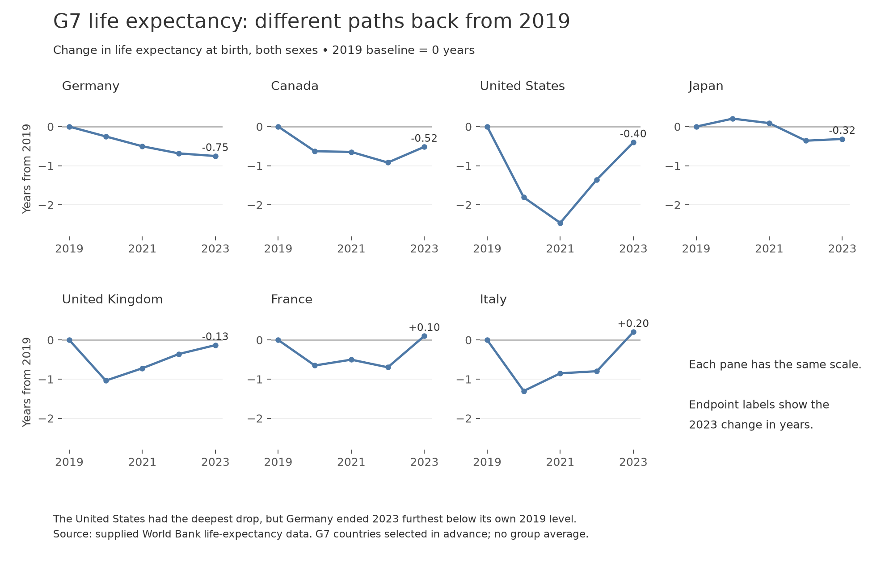
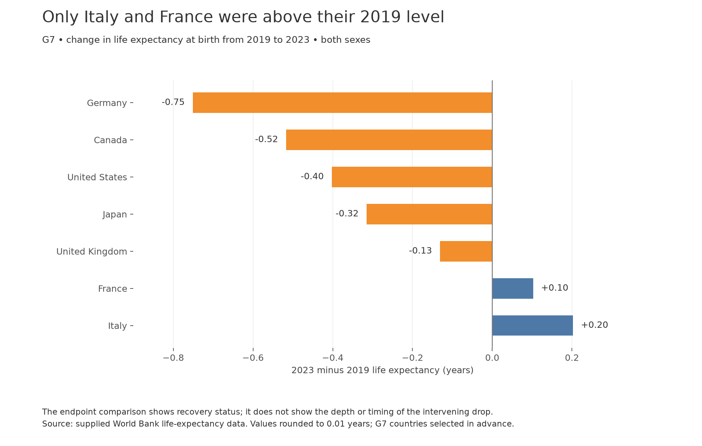
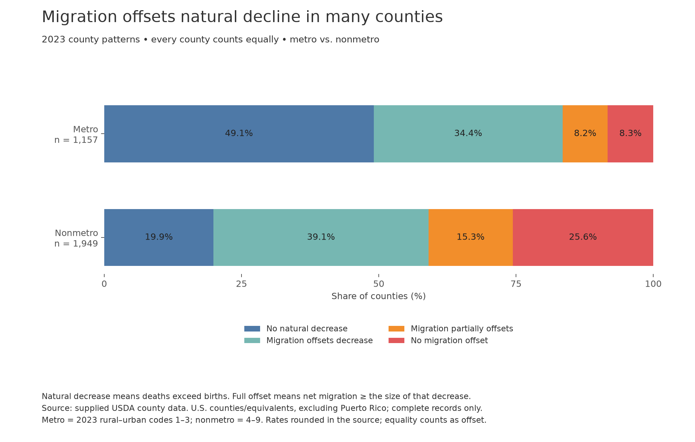
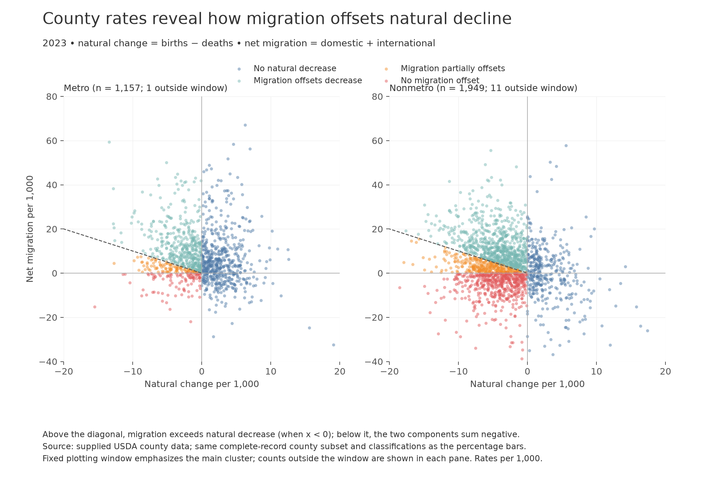
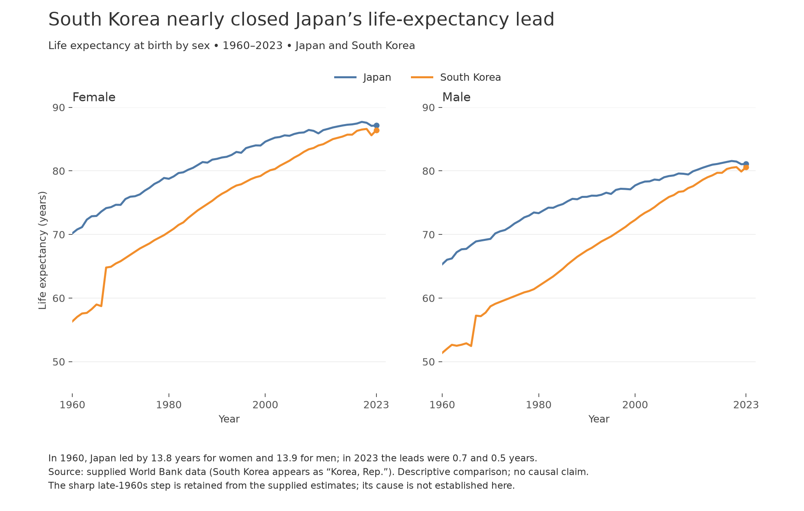
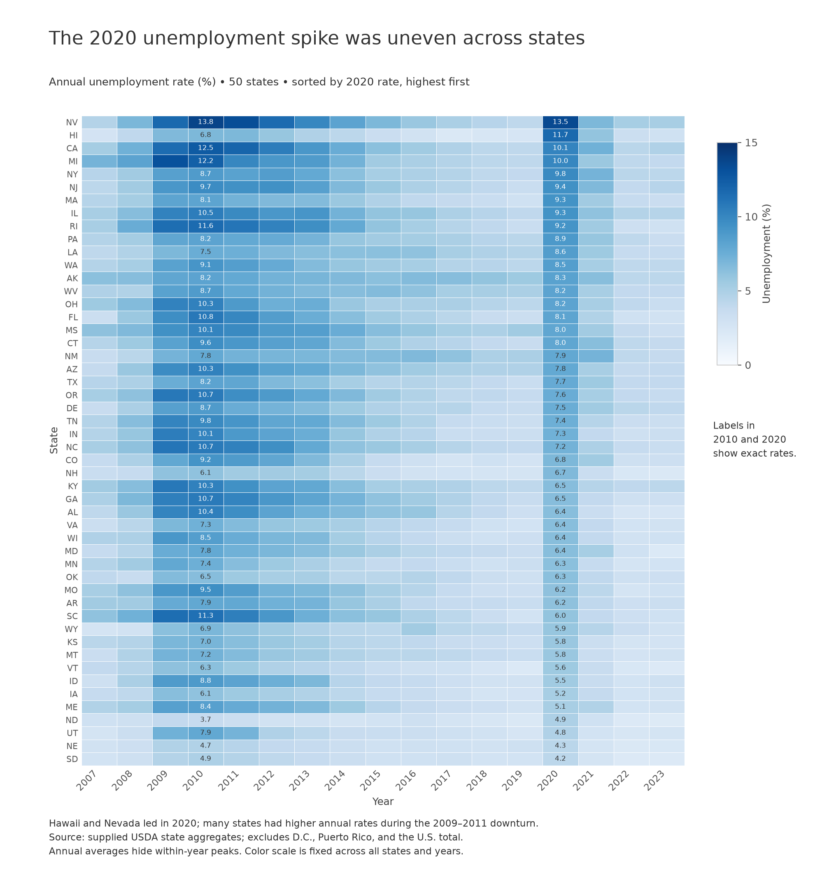

# Instructor-requested example: Design Exercise 4-2

This is an AI-created example for the instructor’s private review, not a student submission. Image filenames below correspond to the Canvas upload questions.

## 1. Critique of the supplied design

The connected dots make the within-state range easy to see, and the blue/orange distinction consistently separates the maximum and minimum county medians. A shared dollar axis supports comparisons between states, while the ratio labels answer a different, useful question about relative spread. Selecting a limited number of states avoids an unreadable display.

The central problem is the claim of “income inequality.” A range of county median household incomes measures differences between county medians, not inequality among households within a state. Two states can have the same county medians and very different household income distributions. The caption’s claims that Wyoming has the lowest and Virginia the highest inequality therefore go beyond what the chart establishes. Even for the narrower county-spread measure, the image does not show all states or describe exclusions, so a national ranking cannot be verified from the figure alone.

I would title it “County median household incomes vary within selected states,” rename the legend “Highest county median” and “Lowest county median,” and label the ratios “Highest ÷ lowest county median.” The states appear ordered by ratio; an explicit sort label would distinguish this from alphabetical or dollar-range ordering. More importantly, the selection rule “top 5, bottom 5, and 6 additional interested states” is ambiguous; I would define the ranked measure and identify the additional states’ purpose. Move state labels to one consistent location, remove the redundant “State” header, and shorten the caption. The zero baseline is valid but spends substantial space below the smallest value; a clearly labeled tighter range would improve separation because position, rather than bar length, carries the values. Finally, include the data source and state whether county estimates are complete. These changes preserve the effective range display while making its interpretation defensible.

## 2. Story / Question 1

How did the G7 countries’ life expectancy at birth change from their own 2019 baselines through 2023, and which regained that baseline? The United States had the deepest drop, yet Germany ended 2023 with the largest remaining deficit; only Italy and France finished above 2019.

## 3. First visualization for Question 1

Upload `figures/01_g7_paths.png`.

## 4. Rationale for the first visualization

Country panes show annual change from 2019 rather than absolute life expectancy. That calculation matches the recovery question and prevents initial differences between countries from dominating the comparison. Every pane uses the same vertical limits and a zero reference line. Lines show timing and direction; point marks make the five annual observations explicit. One color is sufficient because country identity comes from pane headings. The panes follow the 2023 deficit order, and endpoint labels make the result available without tooltips. The G7 is a recognizable, bounded comparison set chosen as a group, rather than a sample selected for extreme results. It is not representative of the world. The caption identifies the source and avoids attributing the changes to any particular cause.

## 5. Alternate visualization for Question 1

Upload `figures/02_g7_endpoint.png`.

## 6. Rationale for the alternate

Sorted horizontal bars encode the signed 2023-minus-2019 difference against a common zero. This makes the remaining deficit and country ordering easier to compare than separate panes. Color redundantly distinguishes negative and positive changes; direction and signed labels also carry that meaning. Full country names fit beside horizontal bars. The axis includes all bar endpoints, and the values are labeled to two decimals. The title states the result directly, while the caption warns that an endpoint comparison omits the depth and timing of the intervening changes.

## 7. Comparison of the two Question 1 visualizations

The paneled lines are stronger for understanding the recovery process: the United States’ 2021 low, Germany’s continuing decline, and Japan’s later dip remain visible. Their weakness is that endpoint rankings require moving between panes. The bars put all endpoints on one axis, so Germany’s −0.75 years and Italy’s +0.20 years are immediately comparable. Their weakness is information loss: the United States’ −0.40-year endpoint conceals its much larger intervening decline. I would use the lines for an explanation of differing trajectories and the bars for a concise summary of recovery status. Both use the same countries, years, sex category, and baseline calculation.

## 8. Story / Question 2

In 2023, how often did net migration fully or partially offset natural population decrease in metro versus nonmetro U.S. counties? Natural decrease was more common in nonmetro counties, which also had a larger share of counties receiving no migration offset.

## 9. First visualization for Question 2

Upload `figures/03_county_shares.png`.

## 10. Rationale for the first visualization

A four-category calculation distinguishes no natural decrease, a decrease fully offset by migration, a decrease partially offset by positive migration, and a decrease with zero or negative migration. Two 100% stacked bars compare the prevalence of these patterns despite unequal numbers of counties. Each county contributes one observation; this is a geographic prevalence comparison, not the share of residents affected. Counts beside the bars and percentage labels make the denominators explicit. The two largest outer categories have common baselines; the labeled interior categories require more care to compare. Stable category colors connect this view to the alternate.

The result is more specific than “rural areas are shrinking”: 39.1% of all nonmetro counties had natural decrease fully offset by migration, while 25.6% had natural decrease with no offset. The corresponding metro shares are 34.4% and 8.3%. These percentages describe the two components, not necessarily the dataset’s reported total population change, which may include residual adjustments. The caption defines metro/nonmetro and the equality convention for rounded rates.

## 11. Alternate visualization for Question 2

Upload `figures/04_county_rates.png`.

## 12. Rationale for the alternate

Each county is a circle positioned by natural change and net migration, both per 1,000 residents. The two panes use identical linear scales, so a difference in the cloud’s location reflects data rather than axis choices. Color uses the same four-category calculation as the bars. Zero reference lines identify natural decrease and migration loss. For counties left of zero, the dashed line at net migration = −natural change is the threshold where migration offsets the decrease. The caption explains that threshold without depending on interaction.

Small transparent marks limit overplotting. A fixed window of −20 to +20 for natural change and −40 to +80 for migration exposes the main cluster; one metro and eleven nonmetro counties lie outside it. Each pane reports those omissions, and the percentage chart retains all complete records. The plot shows considerable variation within both groups, including nonmetro counties whose positive migration exceeds their natural decrease. No trend line is added because this is a component-balance question, not an attempt to fit a relationship or infer causation.

## 13. Comparison of the two Question 2 visualizations

The percentage bars answer “how often?” directly and include every eligible county. They simplify a county’s rates into a category, hiding whether an offset is slight or large. The scatterplots answer “by how much?” and reveal the continuous variation behind the categories, but overlapping marks cannot provide reliable counts. The small clipped tail is another limit of the scatterplots. The designs complement each other: the bars establish prevalence, and the rate plots explain what those categories contain. Both are county-weighted and use 2023 rural–urban classifications; neither is a resident-weighted national summary.

## 14. Story / Question 3

How did South Korea’s life-expectancy disadvantage relative to Japan change between 1960 and 2023 for women and men? Japan’s lead narrowed from about 14 years for each sex to less than one year, while women continued to have longer life expectancy in both countries.

## 15. Visualization for Question 3

Upload `figures/05_japan_korea.png`.

## 16. Rationale for Visualization 3

Separate female and male panes keep each comparison to two lines, avoiding a four-line color-and-style key. Country color is consistent across the panes. Shared vertical limits permit comparison of female and male levels as well as within-sex convergence. The 1960–2023 extent shows that the narrowing occurred over decades; choosing only two endpoint years would hide the different trajectories. The caption quantifies the early and late gaps, while the lines show their context. The vertical scale begins at 45 years to give the observed trajectories useful space; these are position-encoded lines, not length-encoded bars. The chart uses the supplied country definitions throughout and makes no claim about the cause of convergence. South Korea’s conspicuous late-1960s step is retained as supplied and identified in the caption; I do not infer a sudden causal event or smooth it away. Japan and South Korea are a focused pair, not a global ranking.

## 17. Story / Question 4

How did the timing and severity of annual state unemployment differ between the late-2000s downturn and 2020? Nevada and Hawaii had the highest 2020 rates, but many states recorded higher annual rates during 2009–2011 than in 2020.

## 18. Visualization for Question 4

Upload `figures/06_state_unemployment.png`.

## 19. Rationale for Visualization 4

A state-by-year highlight table fits all 50 states and 17 years on a single page. Year stays chronological, making the sustained dark band around 2009–2011 distinguishable from the more concentrated 2020 spike. Sorting rows by 2020 rate concentrates that year’s highest values at the top without discarding lower-rate states. A single sequential blue scale has a fixed 0–15% domain across every cell; it encodes magnitude without implying negative unemployment or separate qualitative classes. Exact labels in 2010 and 2020 support two useful cross-sections while leaving other cells uncluttered. The full 2009–2011 band remains visible because states’ earlier peaks do not necessarily occur in 2010. The source’s state-level rates are used directly, rather than averaging county percentages. The caption identifies the exclusions and explains that annual averages conceal within-year peaks. Color is less precise than position, but it is effective here for comparing timing and geographic concentration at this scale.

## 20. Tools, processing, and AI disclosure

This instructor-requested example was created by OpenAI Codex, which selected the questions, explored and checked the data, wrote and ran the plotting code, designed the figures, inspected exported images, and drafted all responses, including the critique. There is no claim of independent student authorship or human validation. This is a complete AI contribution, not merely proofreading or programming assistance.

Actual tools were Python 3.14 in the existing `p314` conda environment, pandas for loading/filtering/reshaping/calculations, NumPy for classifications and arrays, Matplotlib for all six static PNG exports, Pillow for PNG integrity checks, and shell tools for file handling. The supplied critique image and exported figures were inspected with the image-viewing tool. Tableau was not used, and these are not Tableau exports. Their designs intentionally use ordinary worksheet operations that could be implemented in Tableau: panes, line and bar marks, country/state filters, calculated differences, grouped counts and percentages, category color, sorting, labels, reference lines, and a state-by-year highlight table. The diagonal in the scatterplot is a simple calculated threshold that could be added as a second line layer.

Only the saved references and supplied data were used; no websites were opened and no external data were joined. The World Bank file was filtered to the requested country/sex/year subsets; the G7 changes subtract each country’s 2019 Both-sex estimate. Japan/South Korea use the Female and Male estimates directly. No means of countries were substituted for the supplied estimates.

The county file is actually comma-delimited despite its readme’s tab-delimited warning; its text was decoded as Windows-1252. FIPS identifiers were read as strings. Puerto Rico was excluded, along with records lacking a 2023 rural–urban code or either required 2023 rate. The retained subset contains 3,106 counties/equivalents: 1,157 metro and 1,949 nonmetro. Codes 1–3 define metro; 4–9 define nonmetro. Given natural change rate N and net migration rate M: N ≥ 0 means no natural decrease; N < 0 and M ≥ −N means full offset; N < 0 and 0 < M < −N means partial offset; otherwise N < 0 and M ≤ 0 means no offset. Classification uses the supplied rounded rates, with equality treated as full offset. Percentages divide category counts by all complete counties in the respective group, including counties with no natural decrease. No population weights were applied. The alternate scatter uses fixed axes that clip 12 counties; those counties remain in the percentage summary.

The state file is tab-delimited. Its supplied unemployment rates for 2007–2023 were reshaped into a state-by-year matrix; the U.S. total, D.C., and Puerto Rico were excluded to retain exactly 50 states. Rows are sorted by 2020 rate, with source order retained for ties. No causal models or outside explanatory variables were used. Scripts and processed chart tables remain in `work/`, with regeneration instructions in `work/README.md`.
